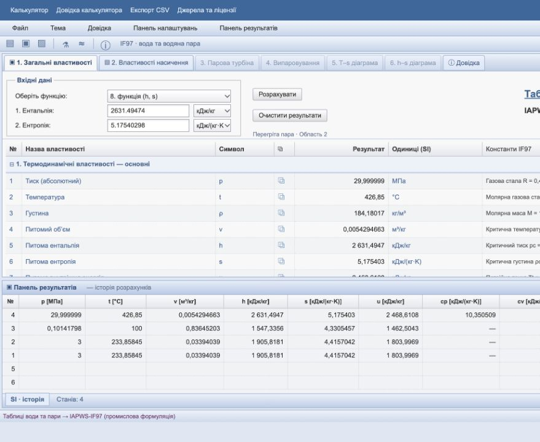

# Таблиці води та пари / IAPWS-IF97

Автономний статичний калькулятор з українським UI. Відкрийте **index.html** у сучасному браузері — сервер, інтернет і встановлення пакетів не потрібні. У файлі вже є всі стилі, JavaScript та WebAssembly. Той самий файл у `dist/index.html` готовий до GitHub Pages.

## Можливості

- P–T, P–h, P–s, P–x, T–x, h–s; насичення за P або T з обома фазами.
- Ентальпія h, ентропія s, густина ρ, питомий об’єм v, внутрішня енергія u, Cp, Cv, швидкість звуку.
- Динамічна в’язкість: IAPWS R12-08, **промисловий варіант μ₂ = 1**, як рекомендовано для IF97.
- Теплопровідність: IAPWS R15-11 §3, **включно з критичним доданком λ₂** і офіційною промисловою кореляцією стисливості при TR.
- 30 показників: додатково енергії Гельмгольца/Гіббса, Z, ізентропний показник, аналітичні похідні, коефіцієнти Джоуля–Томсона, кінематична в’язкість, температуропровідність і число Прандтля.
- Поверхневий натяг рівноважної межі рідина–пара: IAPWS R1-76(2014), 273,16–647,096 K, без екстраполяції.
- Сухість x: частка 0–1 або 0–100%.
- Тиск МПа/кПа/Па/бар/атм, температура °C/K, енергія кДж або Дж; одиниці входу перемикаються з перерахунком значення. Тиск **абсолютний**, не манометричний.
- Десяткова кома або крапка, контроль діапазону, CSV з неокругленими результатами, контрольні приклади, адаптивний інтерфейс.

## Поточний інтерфейс

Табличний інтерфейс із блакитно-сірою темою: вкладки, введення над таблицею, налаштування праворуч і історія станів унизу. Є очищення історії, CSV поточного стану та всього журналу, друк, перемикання теми та довідка. Групи властивостей і бічні панелі згортаються. Висоту журналу можна змінювати перетягуванням роздільника або клавішами ↑/↓. Колонка констант і заголовок таблиці залишаються доступними під час прокручування. Повний екран працює в браузерах із підтримкою Fullscreen API. Історія автоматично зберігається в localStorage поточного браузера (до 500 станів); енергетичні колонки історії завжди у кДж.

Це незалежна реалізація, не продукт MegaWatSoft. Код, торгові позначення та графічні ресурси Steam Tables Online не включені. IAPWS-95 ще не реалізовано; відповідний перемикач вимкнений. Процеси й діаграми мають власний інтерфейс; повна тотожність усім функціям аналога не заявляється. Підтримуються вісім режимів із переліку вище, не всі 16 режимів аналога.



## Модель і межі

Основні рівняння IAPWS R7-97(2012), а не апроксимації через теплоємність або ідеальний газ:

| Область | Реалізація |
|---|---|
| 1 | Gibbs, Eq. 7, аналітичні перші й другі похідні |
| 2 | Gibbs, Eqs. 15–17, аналітичні похідні |
| 3 | Helmholtz, Eq. 28; Newton з контролем стабільної гілки за заданими P–T |
| 4 | Насичення, Eqs. 30–31; рівноважні властивості фаз і масовий ступінь сухості |
| 5 | Gibbs, Eqs. 32–34 (редакція з верхньою межею 50 МПа) |

- 273,15 ≤ T ≤ 1073,15 K: 0 < P ≤ 100 МПа.
- 1073,15 < T ≤ 2273,15 K: 0 < P ≤ 50 МПа.
- Насичення: 273,15 ≤ T ≤ 647,096 K, P від 0,000611212677444… до 22,064 МПа. Нижня межа — тиск насичення IF97 при 273,15 K, **не** тиск потрійної точки 611,657 Па.
- Межа 2/3 — офіційне рівняння B23, 1/3 — 623,15 K, 2/5 — 1073,15 K.
- Транспортні значення показуються лише до 1173,15 K в допустимих діапазонах тиску IF97; за вищої T стоїть «—» з поясненням. Екстраполяції не подаються як стандартні значення.
- Лід і окрема формуляція метастабільної пари не реалізовані. Поблизу 273,15–273,16 K показується пояснення можливого метастабільного стану відносно льоду.

### Інверсії й неоднозначність

P–h / P–s / P–x / T–x: спочатку перевіряється двофазний інтервал. У суміші h, s, u, v визначаються масовим балансом фаз; **ρ = 1/v**, а не середнім густин. Cp/Cv, w, μ, λ суміші не усереднюються: «—». Властивості окремих фаз наведено в таблиці. На кінцях x = 0 і 1 наведено однофазні властивості насиченої рідини/пари.

В однофазній області інверсія виконується бісекцією основних рівнянь, окремо в кожному регіоні. Критерій нев’язки: 2×10⁻⁸ кДж/кг для h або 2×10⁻¹¹ кДж/(кг·K) для s. Це числова збіжність, а не фізична невизначеність IF97. Значення з офіційних backward-таблиць T(p,h)/T(p,s) можуть трохи відрізнятися: тут розв’язуються основні рівняння, а не відтворюється backward-поліном.

h–s: чисельне розв’язання основних рівнянь через P–h, зі стартовим тиском SEUIF97, демпфованим Newton і резервним пошуком у логарифмі тиску. Перевіряються нев’язки h < 10⁻⁶ кДж/кг та s < 2×10⁻¹¹ кДж/(кг·K). Резервний пошук охоплює 10⁻¹²–100 МПа; надзвичайно низькі тиски, розриви меж або незбіжність можуть дати явну помилку. Це інверсія основних рівнянь, а не відтворення офіційного backward-полінома p(h,s). У критичній точці P–x/T–x відхиляються, бо x не визначений.

Похідні й транспортні показники двофазної суміші не усереднюються; поверхневий натяг описує межу між рівноважними фазами. CSV поточного стану включає всі 30 показників; CSV історії зберігає компактний набір 13 числових колонок.

Рівняння різних областей IF97 мають малі дозволені неузгодженості. Якщо виникає перекриття й кілька коренів інверсії, UI пояснює це, показує корінь з нижчою T і температури інших коренів. Якщо значення потрапляє в розрив, видається помилка; штучної інтерполяції немає.

На лінії насичення P–T не визначає x: показуються обидві фази, властивості суміші не вигадуються. У критичній точці ρ = 322 кг/м³, x невизначений, Cp і λ не подаються як скінченні числа. Надзвичайно близько до критичної точки похідні IF97 чутливі; у разі незбіжності видається явне повідомлення.

### Залежності та ліцензії

SEUIF97 2.3.8 включено в `vendor/`; використовується для початкових наближень густини області 3 та тиску h–s. Кінцеві властивості розраховуються власним JS за основними рівняннями та перевіреним коренем тиску. Запити npm, runtime CDN, API, телеметрія, fetch WASM під час роботи сторінки **відсутні**. Посилання на документацію відкриваються лише за бажанням користувача.

Програмний код: MIT. Повні тексти, перевірені джерела й атрибуція IAPWS: [THIRD_PARTY_NOTICES.md](THIRD_PARTY_NOTICES.md), [LICENSE](LICENSE), [vendor/SEUIF97-LICENSE](vendor/SEUIF97-LICENSE). Згенерований HTML також містить license notices.

## Локальна розробка

Node.js ≥20, без `npm install` і без сторонніх build-пакетів:

```sh
npm test
npm run build
```

`build` створює/оновлює автономні `index.html` і `dist/index.html`. Обидва відстежуються в Git, щоб можна було використати готовий файл без збірки. Редагуйте файли `src/`, а не згенерований HTML.

За бажанням HTTP preview:

```sh
python3 -m http.server 8080 --bind 127.0.0.1
```

Відкрийте http://127.0.0.1:8080/. Це лише локальний сервер статичних файлів для розробки, не backend калькулятора.

## Перевірка

`npm test` використовує лише стандартний `node:test` і локальний WASM. Офіційні значення в `tests/official.test.mjs`:

- R7-97: усі 3 точки таблиць 5, 15, 33, 35, 37, 42.
- R12-08: усі 11 точок таблиці 4 для μ₂ = 1.
- R15-11: таблиці 4, 7, 8 і 9, включно з промисловим критичним доданком.
- R1-76(2014): 7 контрольних значень розрахованої поверхневої напруги з таблиці 1.
- Інверсії, фазові кінці, суміші, межі, одиниці, сингулярності й відхилення неправильних даних.

Більшість контрольних значень надрукована з 9 значущими цифрами; для них відносний допуск 5×10⁻⁹ (для в’язкості 5×10⁻⁸ відповідно до точності таблиці). Фактичний звіт: [docs/VALIDATION.md](docs/VALIDATION.md).

## Підготовка GitHub та GitHub Pages

Код розміщено у приватному репозиторії `lamerroma/water-steam-if97`. Сайт GitHub Pages не опубліковано. Його запуск потребує окремого погодження; для приватного репозиторію доступність Pages залежить від тарифу GitHub.

1. У репозиторії вже є вихідний код, тести, `.github`, `vendor`, LICENSE та атрибуція. Абсолютних URL для assets немає.
2. У Settings → Pages → Build and deployment виберіть **GitHub Actions**.
3. Після окремого рішення про публікацію запустіть Actions → **Publish GitHub Pages (manual)** → Run workflow з потрібної гілки.
4. Workflow перевірить тести, збере автономний HTML і опублікує `dist/`. URL буде в результаті deploy job.

Pages workflow запускається **лише вручну** (`workflow_dispatch`), не на push. CI перевіряє тести й відтворюваність збірки на push/PR без публікації. GitHub Actions потребує мережі лише під час CI/публікації; готовий калькулятор її не потребує.

Можна також розмістити `index.html` на будь-якому статичному хостингу або надіслати єдиний файл. Для GitHub Pages project site підтримується шлях `/repository-name/`, бо немає кореневих посилань на assets.

## Турбіна, випаровування та діаграми

- Турбіна: однофазний паровий вхід P–T, вихідний тиск, ізоентропний ККД у %, витрата у кг/с. h₂s = h(p₂,s₁); h₂ = h₁ − η(h₁−h₂s); робота = h₁−h₂, потужність у кВт = витрата × робота. Модель адіабатична, без механічних/генераторних втрат та змін кінетичної/потенціальної енергії.
- Випаровування: адіабатичне дроселювання h₂=h₁. Для рівноважної суміші витрати пари й рідини = mx та m(1−x). Для однофазного виходу баланс сепарації не показується. Вхід P–T на насиченні відхиляється як неоднозначний. Нагрівання з підведенням тепла й багатоступенева сепарація не моделюються.
- Вихід процесу можна перенести до загальних властивостей, журналу та CSV. У формах процесів перемикаються МПа/бар/кПа, °C/K, кг/с або кг/год; таблиці результатів і CSV мають явно зазначені SI-одиниці; перемикач енергії загального калькулятора на них не діє.
- T–s та h–s: насичення, сім ізобар 0,01–100 МПа, точки журналу з підказками та завантаження автономного SVG. Точки обчислюються за IF97; лінійні сегменти служать лише для малювання. Графіки мають фіксовані діапазони: s 0–11 кДж/(кг·K), t 0–800 °C або h 0–4500 кДж/кг. Вони не охоплюють всю область 5; доступні масштабування кнопками/колесом, переміщення перетягуванням/стрілками та вибір позначених точок мишею або Enter.

Розрахований процес наноситься кнопкою «Нанести процес на h–s діаграму» й доступний також на T–s. Зелений відрізок з’єднує вхід і фактичний вихід; пунктир — вхід та ізоентропний вихід турбіни. Це з’єднання кінцевих станів, не модель проміжного шляху реальної турбіни. На графіку зберігається останній успішний процес до кнопки «Прибрати процес» або перезавантаження. Вибрану точку можна перенести до загальних властивостей. SVG зберігає поточний масштаб.

## Збереження проєкту

Автоматично зберігаються журнал (до 500 станів), введення загального калькулятора, чернетки форм процесів, останній успішний процес, тема, енергетичні одиниці та масштаб UI. Збереження локальне для браузера й адреси сторінки; при очищенні даних браузера воно зникає. Приватний режим або file:// можуть обмежувати localStorage: для перенесення використовуйте Файл → Експорт/Імпорт проєкту JSON. Імпорт замінює поточний проєкт, максимальний розмір 2 МБ; стани й процеси перераховуються з входів за IF97. Масштаб діаграми й геометрія панелей не зберігаються. CSV процесу доступний після успішного розрахунку.
