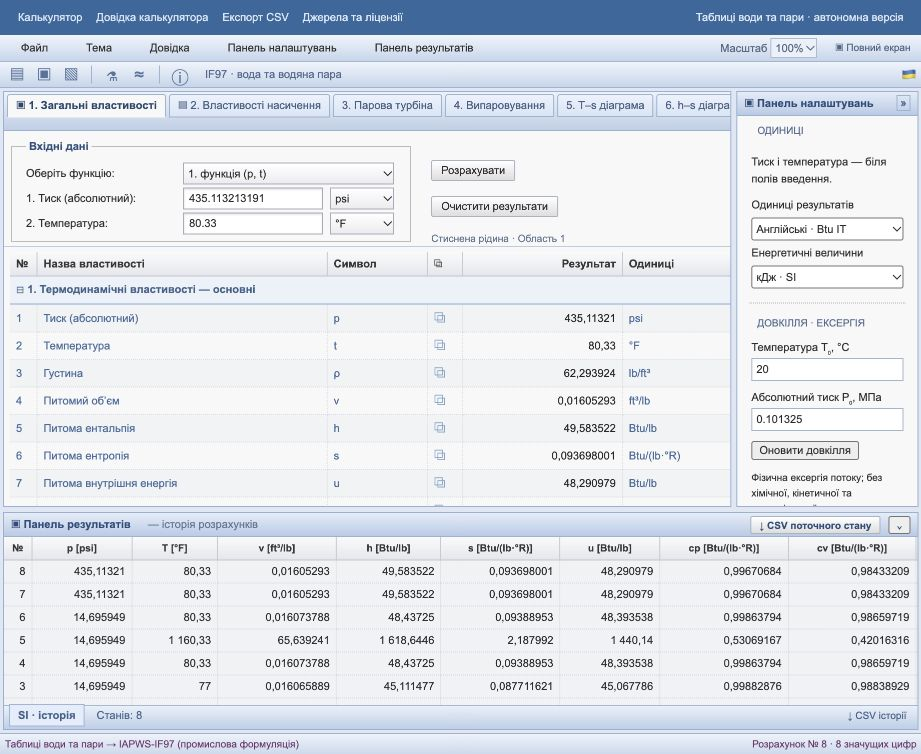

# Звірка зі Steam Tables Online, 2026-10-10

Джерело: https://www.steamtablesonline.com/Steam97Web.aspx. Перевірено відкритий інтерфейс без входу в обліковий запис. Сайт показує вимоги реєстрації для частини властивостей. Контрольний P–T запит 30 бар / 26,85 °C після натискання калькуляції на той момент не повернув числових результатів; причину не встановлено.

**Числовий збіг підтверджено окремо.** Перехоплено фактичну мережеву відповідь сервера steamtablesonline.com для p = 1 МПа (10 бар), t = 250 °C (область 2) і звірено з цим калькулятором на тих самих вхідних даних:

| Властивість | steamtablesonline.com (сервер) | Цей калькулятор | Збіг |
|---|---|---|---|
| v, м³/кг | 0,2327389333 | 0,23273893 | до 7–8 знаків |
| h, кДж/кг | 2943,2221652337 | 2 943,2222 | так |
| s, кДж/(кг·K) | 6,9266227397 | 6,9266227 | так |
| u, кДж/кг | 2710,4832319337 | 2 710,4832 | так |
| cp, кДж/(кг·K) | 2,2116202733 | 2,2116203 | так |
| cv, кДж/(кг·K) | 1,6361901740 | 1,6361902 | так |
| w, м/с | 550,1074973272 | 550,1075 | так |

Отже числова тотожність для цієї точки підтверджена незалежно від запиту через UI оригіналу. Авторитетною перевіркою ядра лишаються офіційні таблиці IAPWS та тести — ця звірка лише додаткове підтвердження на прикладі комерційного движка.

| Модуль | Оригінал | Наша реалізація / залишок |
|---|---|---|
| Турбіна | Три режими: витрата пари, ККД, потужність; потужність MW | ККД та витрата задані, розраховуються робота й потужність kW. Зворотні режими витрати та ККД реалізовані; потужність у кВт |
| Флеш-випарник | Вибір насиченого або переохолодженого конденсату | Однофазний P–T вхід. Окремий насичений вхід реалізований |
| Властивості | 32 рядки, включно з ексергією та діелектричною сталою | 32 рядки. Ексергію додано з явними P₀/T₀; діелектричну сталу додано за R8-97 з явно зазначеною густиною IF97 |
| Одиниці | SI та англійські; бар, %, мкПа·с, мм²/с, мН/м | Повний набір англійських IT-одиниць реалізовано для калькулятора, процесів і експорту (p, t, h, s, ρ, v, w тощо) |
| Діаграми/інші вкладки | Додаткова h–s для пари та газові таблиці | T–s/h–s для води; з версії 1.1.0 додано окремі вкладки газів/сумішей (NASA7), вологого повітря та навчальних циклів Ренкіна/Брайтона; IAPWS-95 реалізовано як окрема формуляція |

## Перевірка в браузері та виправлення

- Експорт JSON завантажено в Downloads; перевірено format/version/history/process.
- Імпорт зміненого контрольного файлу відновив введення 7 МПа, журнал і процес.
- JSON version=999 відхилено, поточне введення 7 МПа залишилося.
- Колесо змінило діапазон s 0…11 → −1,426…12,324; перетягування змінило його до −2,579…11,171.
- Виправлено смугу прокручування, що перекривала вкладки на ширині близько 921 px; h–s тепер відкривається натисканням.
- Меню Файл закривається після запуску імпорту/експорту.
- Знімок audit-browser.png. 82 тести проходять; точність рівнянь не змінювалася.

Числову таблицю відмінностей від оригіналу можна завершити лише коли його калькулятор поверне результати. До того не підмінюємо цю звірку порівнянням із власним ядром.

## Англійські одиниці — перевірка браузера

Перевірено кнопку «Розрахувати» з 435.11321319062773 psi і 80.33 °F (3 MPa, 300 K): h = 49.583522 Btu IT/lb, cp = 0.99670684 Btu IT/(lb·°R). Турбіна: 600 kW = 2047284.9798767653 Btu/h; режим обчислення витрати, одиниці lb/s. Перемикання результатів SI/англійські, відновлення чернеток після reload і завантаження CSV процесу пройшли. Діаграми залишаються SI.

## Повторне звірення інтерфейсу (10-кроковий етап)

Зіставлено основну сторінку та флеш-випарник з відкритою Steam97Web.aspx. Збережено компонування: верхні меню/toolbar, вкладки, форма над таблицею, права панель, нижній журнал. Додано робоче меню діаграм, вкладки одиниць унизу, ущільнено рядки й форму, ексергію розміщено після ентропії як у зразку. Не використовуються DLL, JS чи зображення MegaWatSoft. Відмінності: українські виправлені назви, локальне збереження, явні межі й повідомлення; додаткові режими автономного калькулятора. Тотожність пікселів або всього функціоналу зразка не заявляється.

## Повна звірка функціоналу та закриття прогалин, 2026-10-10

Повторна звірка всіх 8 вкладок оригіналу виявила три дрібні прогалини в таблиці вище, усі закрито: питома витрата пари турбіни (кг/(кВт·год)), відсоток пароутворення флеш-випарника (x×100), неон (Ne) як 12-й газовий компонент. Додано власний набір inline SVG-іконок у тулбарі/меню/вкладках (оригінал має іконки — наш набір оригінальний, не запозичений). Свідомо не реалізовано: дисоціація при горінні (складна рівноважна хімія, чекбокс в оригіналі) — задокументовано як поза обсягом, не приховано. Деталі — [CHANGELOG.md](../CHANGELOG.md).
