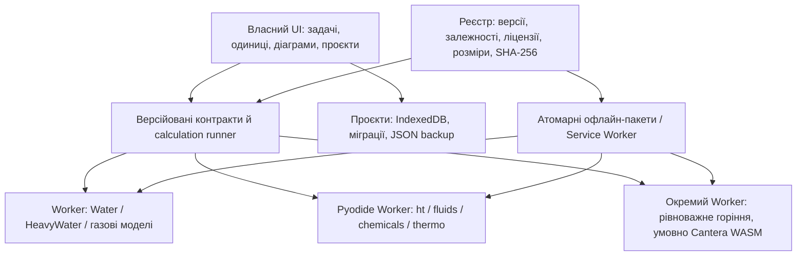

# Повний план розвитку до кінцевої мети

Дата оцінки: **20.10.2026**. Статус: **запропонований план залишку робіт**, а не
підтвердження завершення. [Машиночитний план](DEVELOPMENT_MASTER_PLAN.json)
містить 36 пакетів робіт, залежності, оцінки, зовнішні умови та розраховані суми.

**Стан виконання на 22.10.2026:** R00, R01 і R02 завершено у зазначених
межах. [Публікація 1.40.0](RELEASE_STATUS_UK.md), build `20fd3cb17a71`,
пройшла 106/106 перевірок CI, окремий inverse-full і Pages; сайт перевірено
онлайн, після оновлення й холодного офлайн-запуску в Chromium/Firefox.
Фізичні пристрої та спостереження Firefox залишаються у R13.

Почато **R16**: [підетап R16.1](library-registry/README_UK.md) зафіксував
3494 публічні шляхи та 2966 записів ht/fluids, додав рекурсивний доступ,
профілі runtime і перевірки реєстру. Кандидат 1.41.0 ще не опубліковано.
[R16.2a](library-registry/R16_2_UK.md) додав типізований час, захист сеансів
об’єктів і експорт помилок. [Наступний підетап](library-recipes/README_UK.md)
додав сценарії реконструкції об’єктів, збереження команд у проєкті й холодний
офлайн-перезапуск. Контрольний піднабір TANK не завершує R16.2b:
повні контракти, optional-варіанти й решта динамічного стану відкриті.
Числове приймання всього API та паритет Steam97Web цим не підтверджено.

Нижче збережено **початкові сценарні оцінки та вихідну точку планування**.
Їхні суми вже не є новою оцінкою залишку після виконаних R00–R02.
R21/R26 потребують переоцінки після R16.2 і перших виміряних предметних
сценаріїв; кількість aliases чи об'єктів не замінює цю роботу.

Позапланове відновлення завершено в перевірених межах: [1.40.1](RELEASE_STATUS_UK.md)
опубліковано, CI 110/110, старі функції зіставлено з 1.35.12 й перевірено
публічно в Chromium/Firefox онлайн та офлайн. Відомі фізичні обмеження збережено.

[Перевірку й відновлення старих функцій](PWA_LEGACY_CHECK_UK.md) завершено
в зазначених межах. Нові модулі та R17 до цього випуску не включено.

## Кінцева мета і межі

**Ціль S1:** повне функціональне покриття Steam97Web: вода/пара, насичення,
транспорт, газові таблиці й дисоціація, турбіна/flash, діаграми, серії, одиниці,
збереження та експорт. Відповідність означає узгоджені постановки й результати,
а не тільки схожі вкладки. Це перший пріоритет [стратегії](PRODUCT_STRATEGY_UK.md).

**Ціль S3:** після S1 — завершена модульна інженерна PWA: усі розрахункові
можливості зафіксованих ht/fluids; прийняті Water/HeavyWater; погоджений модуль
речовин/VLE через chemicals/thermo; окреме рівноважне горіння через Cantera;
спільні властивості, одиниці, проєкти та відтворювані офлайн-сценарії.

Формат — багатофайлова PWA з локальними розрахунками. Важкі двигуни й дані
завантажуються окремими перевіреними пакетами. Після підготовки всіх потрібних
пакетів їхні розрахунки працюють без інтернету. Зберігаємо повний локальний ZIP;
однофайлову програму не повертаємо. Наявний HTML-експорт звіту залишається.

Власний код зосереджується на адаптерах, контрактах, UI, збереженні й перевірках.
Чужий чисельний код фіксуємо за версією/хешем та використовуємо без переписування
всіх алгоритмів JavaScript. Старі ядра прибираємо лише після прийнятої заміни
того самого потрібного контракту. Окремі IF97/IAPWS-95/NASA7/BSW/рівноважні
моделі не оголошуємо взаємозамінними.

Повний API chemicals/thermo або Cantera, кінетика, мережі реакторів, 1D-полум’я,
мережевий гідравлічний solver та нова ядерна нейтроніка **не включені автоматично**.
Для M6/M7 нижче оцінено конкретний початковий контракт, який уточнюється на
дослідному етапі. Наявні дослідні реакторні модулі зберігають свої обмеження;
їхня фізична сертифікація — окремий обсяг. [Нейтронний аудит](REACTOR_CELL_VALIDATION_UK.md)
поки не пройдено. План не перетворює його на прийнятий інженерний розрахунок.

## Історична вихідна точка планування (20.10.2026)

Позначення: **спостережено** — поточний репозиторій/збережений протокол;
**запропоновано** — майбутня робота/оцінка; **умовно** — залежить від досліджень
або зовнішніх даних. Нового сеансу Steam97Web і нових числових тестів цього
планувального кроку не виконували.

- Спостережено: HEAD гілки `codex/open-library-modules` і remote `main` за
  read-only `git ls-remote` — `65e9199068659ec5c183081d5e5908244bb2beea`.
  Наявні незакомічені зміни HEOS збережені. План не є їхнім комітом чи публікацією.
- Останній збережений [протокол публікації](release-1.39.0/REPORT_UK.md): 1.39.0,
  build `0268d327cdad`. Поточний deployment цим кроком повторно не перевірено.
- Локальний кандидат: 1.39.0, build `db5b8d43d6ea`, адаптер HEOS 1.2.0;
  20 пар входів, основна форма/історія/змішані проєкти/серії/цикли.
  [Приймання](water-heos/acceptance-workspace.json): Node 22 — 1792/1792,
  core — 20/20; матриця — 582 збіги, 6 допустимих неоднозначностей,
  7 випадків обумовленості інверсії, 0 відмов. Це не 595 однаково точних збігів.
- HEOS ще не опубліковано; повний browser release suite, повна пам’ять/швидкодія
  та фізичні мобільні пристрої не прийняті. Node 24 — 1791/1792 через відомий
  старий збій IAPWS-95. [Межі поточного етапу](WATER_HEOS_WORKSPACE_UK.md).
- [Матриця](STEAMTABLES_PARITY_MATRIX.json): **86 рядків; 79 present, 7 partial**;
  parity: 85 requires_reference_cases, 1 known_gap. Інвентар незавершений,
  відсоток готовності не визначений. Числа 69/10/7 у старому плані — історичний зріз.
- Збережений збір Steam97Web: 20 випадків, усі `Registration Required`,
  **0 числових результатів оригіналу**. Файли лежать у батьківській папці:
  `STEAM97_REFERENCE_REPORT_UK.md`, `steam97-reference-cases.json`, `steam97-evidence/`.
  R00 уже зберіг [керований архів із хешами](steam97-reference/README_UK.md);
  початкові локальні файли не редагувалися.
- [ht/fluids уже підключені](HT_FLUIDS_INTEGRATION_UK.md): ht 1.2.0,
  fluids 1.3.1, Pyodide Worker, каталог, класи/масиви, окремий офлайн-пакет
  **31 973 269 байтів**. Каталоги мають 858 і 2252 записи **включно з aliases**;
  це не 3110 незалежних алгоритмів. Трубопровід прийнято окремо, решту API — ні.
- P03 реалізовано, первинна перевірка коефіцієнтів і паритет відкриті.
  P04 — [дослідна калорична поправка](steam97-p04/contract.json),
  не підтверджена рівновага і не повний контракт оригіналу.

## Як розраховано строки та обсяг

Усі оцінки нижче **запропоновані**, отримані декомпозицією робіт, а не виміром
швидкості цієї розробки. Один інженерний день = **6 продуктивних годин**,
тиждень = **5 днів**. Враховані контракти, код, UI, числове й браузерне
приймання, документація та звичайне виправлення знайдених помилок. Витрачений
раніше час не включено. Орієнтир — один досвідчений виконавець із доступними
інструментами перевірки; це не прогноз кількості повідомлень чи часу роботи AI.

Три сценарії: O — сприятливий; M — робоча оцінка; P — складний.
Плановий орієнтир PERT = `(O + 4×M + P) / 6`. Це спосіб зважування припущень,
**не статистично підтверджена ймовірність**. Додається окремий резерв **25%**
на інтеграцію й невиявлені зв’язки. Він не покриває зміну кінцевого обсягу.
P не є гарантованою верхньою межею. Очікування доступу/даних/пристроїв не
має встановленої тривалості й у днях розробки не заховане.

Підсумок етапу — сума залишкових робіт, не строк критичного шляху команди.
Для одного виконавця тижні нижче означають зайнятість за відсутності зовнішніх
пауз і сторонніх задач. Додавання людей не ділить строк автоматично навпіл:
спільними залишаються контракти, наукова перевірка, інтеграція й приймання.

## Початковий сценарний кошторис трудомісткості

| Етап | O / M / P, інж.-днів | PERT, днів | PERT + 25%, тижнів одного виконавця |
| --- | ---: | ---: | ---: |
| A · Завершення поточного кандидата | 8 / 15 / 25 | 15,5 | 3,88 |
| P · Повне покриття Steam97Web | 33 / 69 / 139 | 74,67 | 18,67 |
| F · Надійна модульна PWA | 19 / 38 / 69 | 40 | 10 |
| W · Вода, HeavyWater і заміна ядер | 11 / 21 / 40 | 22,5 | 5,63 |
| H · Повне покриття ht | 51 / 107 / 205 | 114 | 28,5 |
| L · Повне покриття fluids | 54 / 116 / 229 | 124,5 | 31,13 |
| C · Речовини та суміші chemicals/thermo | 32 / 64 / 120 | 68 | 17 |
| E · Рівноважне горіння Cantera | 25 / 51 / 100 | 54,83 | 13,71 |
| Z · Спільні сценарії й фінальне приймання | 11 / 22 / 44 | 23,83 | 5,96 |

**Увесь розширений обсяг:** O/M/P = **244 / 503 / 971 днів**
без резерву. З резервом — **305 / 628,75 / 1213,75 днів**,
або **61 / 125,75 / 242,75 робочих тижнів**.
Зважений орієнтир — **537,83 дня**, з резервом **672,29 дня**
≈ **134,46 тижня**. Це приблизно 2,6 року зайнятості одного виконавця
по 52 робочі тижні на рік, ще без відпусток і зовнішніх пауз; дата завершення
не обіцяється. Довгий хвіст — повне приймання всіх ht/fluids, а не їх імпорт.

**Перша кінцева ціль S1, тільки A+P:** 41 / 84 /
164 днів без резерву; зважений орієнтир з резервом —
**112,71 дня ≈ 22,54 тижня**.
Вона залежить від доступу до оригіналу; зовнішня пауза може бути необмеженою.
Це оцінка відомого залишку до закриття інвентарю, а не обіцянка, що нових
обов’язкових функцій не знайдеться.

**Проміжна ціль S2, ht/fluids + Water/HeavyWater + PWA** включно з S1,
ще без chemicals/thermo, Cantera та фінальних спільних сценаріїв:
**176 / 366 / 707 днів**
без резерву; зважений орієнтир з резервом —
**488,96 дня ≈ 97,79 тижня**.
Це кумулятивна ціль, її не треба вдруге додавати до S1 або S3.

**Найближчий самостійний результат S0:** прийнятий HEOS-кандидат —
8–25 днів без резерву; PERT з резервом **19,38 дня**
≈ **3,88 тижня**. Він корисний
без очікування S1 і не означає повний паритет.

За ставки `r` за годину грошова трудова оцінка дорівнює
`дні × 6 × r`; для всього обсягу за PERT із резервом — приблизно **4034 × r**.
Ставку, бюджет доступів і пристроїв не задано, тому грошову суму не вигадуємо.

## Архітектура кінцевого застосунку

Це цільова схема: IndexedDB, узагальнений менеджер пакетів і Cantera тут
**запропоновані**, а не вже готові. Стан реалізації визначають контракти й
[архітектурний документ](PWA_ARCHITECTURE_UK.md). Спільний Python runtime та
NumPy/SciPy не треба завантажувати вдруге для сумісних пакетів. Кількість
одночасних Worker визначаємо за пам’яттю, а не за кількістю вкладок.

## Порядок робіт і контрольні точки

1. **A → S0:** зберегти базу, закрити поточні ризики HEOS, пройти повне релізне
   приймання й підготувати контрольований випуск. Не додавати нові двигуни до
   неперевіреної основи.
2. **P → S1:** уточнити інвентар/еталони, закрити воду й гази, окремо P04,
   workflows, діаграми та експорти. Наявну реалізацію не переписувати заново.
3. Якщо частина P заблокована доступом, виконувати незалежні визначені
   контракти P та платформні F. За відсутності доступної обов’язкової задачі
   допустимі H/L/W, із явно відкритим S1. Це зберігає роботу, але не змінює
   продуктового пріоритету. Нові підтверджені вимоги оригіналу повертаються вперед.
4. **H/L:** спільний реєстр → короткі корисні форми → решта предметних розділів
   → поелементне закриття API. M3 починається з LMTD/ε–NTU/внутрішньої конвекції;
   M4 — з арматури, далі стисливі й двофазні потоки. Підтримка всіх API не
   зводиться до одного поля JSON.
5. **W:** HeavyWater, потім приймання заміни й видалення дубльованих ядер.
   Автоматичного переведення старих IF97-проєктів у HEOS немає.
6. **C/E:** спочатку короткі дослідні R27/R31. Якщо браузерна збірка, дані чи
   пам’ять непридатні, зупинити залежні реалізації та перерахувати варіанти.
   Серверний розрахунок не підміняє погоджену офлайн-мету.
7. **Z → S3:** спільні сценарії, фінальний аудит, очищення лише зайвого робочого
   коду, повний реліз. Підтримка й нові upstream-версії продовжуються після цього.

Залежності в JSON — технічні передумови; порядок вище визначає пріоритет
використання часу. R10/R16/R27/R31 не потребують очікування завершення всієї P,
але не витісняють доступні обов’язкові роботи оригіналу. Зовнішні gates можуть
блокувати тільки відповідну частину пакета; дослідну/підготовчу частину виконуємо.

Основний залежний ланцюг паритету:
`R00 → R03 → R04 → R06 → R07 → R09`, паралельні передумови —
`R05 → R08 → R09` і `R01 → R02 → R09`.
Для розширень найдовші перевірки проходять через реєстр і повне приймання
ht/fluids. Це логічні ланцюги, не розрахований ресурсний календар;
їх не можна перетворити на дату, поки E01/E02 та остаточний інвентар відкриті.

## Повний перелік пакетів робіт

Оцінки O/M/P — **залишок інженерних днів без загального резерву**.
Початковий кошторис R-пакетів описує залишок; поточні статуси виконання — у JSON.
Пакети не заперечують уже готові частини з вихідної точки. P/M і M1–M7 збережено як старі ідентифікатори,
R00–R35 — наскрізні пакети цього кошторису.

### A. Завершення поточного кандидата

**R00 · Зафіксувати робочу базу й узгодити реєстри — 1 / 2 / 3 днів.**

Передумови: немає. Зв’язок: M2, P01.

Робота:

- Зберегти поточний diff та нові файли у відтворюваному контрольному стані; не скидувати незакомічені зміни.
- Звірити датовані протоколи, матрицю, пакети, версії CI; перенести потрібні зовнішні докази в керований архів із хешами.

Приймання:

- Коміт або перевірений архів відтворює кандидат; історичні докази не переписано.
- Джерело кожного статусу відоме; Node 22/24 та дослідні моделі мають окремі чесні статуси.

**R01 · Завершити приймання поточного HEOS — 5 / 9 / 15 днів.**

Передумови: R00. Зв’язок: M2.

Робота:

- Виміряти холодний/теплий запуск, пікову пам’ять, серії, збої й відновлення Worker; усунути встановлені проблеми.
- Перевірити або ізолювати аварії спільного CoolProp у головному потоці; розібрати відомий збій IAPWS-95 на Node 24 без підміни моделі.

Приймання:

- Збережені числові та браузерні докази поточного HEOS залишаються чинними після виправлень.
- Визначено підтримувані runtime; усі їхні обов’язкові перевірки проходять; обмеження пристроїв і пам’яті виміряно.

**R02 · Повний релізний кандидат HEOS — 2 / 4 / 7 днів.**

Передумови: R01. Зв’язок: M2.

Робота:

- Пройти весь релізний набір, відновлення проєктів, оновлення PWA з опублікованої версії та незалежне читання експортів.
- Підготувати changelog, ліцензії, відтворюваний ZIP, точні commit/build і план відновлення попередньої версії.

Приймання:

- Повний програмний релізний набір і локальна офлайн-перевірка пройдені на узгодженому кандидатові.
- Після окремо виконаної публікації CI/Pages та перевірка живого сайту прив’язані до того самого build; паритет не заявлено.

### P. Повне покриття Steam97Web

**R03 · Завершити інвентар Steam97Web — 3 / 6 / 12 днів.**

Передумови: R00; зовнішні умови: E01. Зв’язок: P01, B01, B02, B03.

Робота:

- Уточнити всі вкладки, насичення, моделі, фази, одиниці, похідні, ексергію, турбіну, flash, діаграми й експорт.
- Зберегти відкриті B01–B09; розділити наявну реалізацію, локальне приймання та пряме підтвердження оригіналу.

Приймання:

- Кожний контроль оригіналу має вимогу, джерело та сценарій або явний блокер.
- Інвентар закрито тільки за доказами; до цього немає відсотка повноти.

**R04 · Зібрати й нормалізувати прямі еталони — 4 / 8 / 15 днів.**

Передумови: R03; зовнішні умови: E01. Зв’язок: P01, P03, P04, B01, B03, B04, B05.

Робота:

- Отримати дозволений доступ до результатів або перевірювані експорти від власника/авторизованого користувача; зафіксувати версію і дату.
- Повторити N₂, усі вісім компонентів, суміш off/on, два базиси/округлення, усі виходи та точні помилки; доповнити матрицю води й workflows.

Приймання:

- Є сирі числа/експорти та скриншоти, точні входи, абсолютний тиск, температура, одиниці, склад і перемикачі.
- Невідомі h/s, λ, kapa, Dissociation і базис не заповнено припущеннями; перевірено і шестизначні, і однакові двозначні склади.

**R05 · Закрити воду, насичення, транспорт і ексергію — 6 / 12 / 22 днів.**

Передумови: R03, R04; зовнішні умови: E01. Зв’язок: P02, P05, P09, B02, B06, B07.

Робота:

- Зіставити всі підтверджені пари/функції насичення, неоднозначні корені, похідні, одиниці та опорний стан ексергії.
- Виправити лише встановлені пропуски; розділити наукові межі EOS і транспорту, допустиму екстраполяцію та поведінку оригіналу.

Приймання:

- Узгоджені входи/виходи, моделі й допуски для кожної вимоги; зворотні режими відтворюють обидва входи.
- Границі фаз, критична область, SI/English, null і помилки перевірені незалежно та через UI.

**R06 · Закрити P03: вісім газів і суміші — 5 / 10 / 20 днів.**

Передумови: R04; зовнішні умови: E01, E02. Зв’язок: P03, B04.

Робота:

- Звірити первинні коефіцієнти BSW2003, включно зі знаком SO₂, молярними масами та газовою сталою.
- Узгодити базиси, ентропію змішування, h/s нулі, тиск, P–T/P–h/P–s; відокремити сталий зсув від залежної від стану похибки.

Приймання:

- Кожний компонент і суміш мають прямі й незалежні числові контролі та зафіксовані допуски.
- Масовий/молярний склад, округлення, проєкт, Worker і чотири формати експорту відтворюють ту саму постановку.

**R07 · Закрити P04 за фактичним контрактом оригіналу — 8 / 18 / 40 днів.**

Передумови: R06; зовнішні умови: E01, E02. Зв’язок: P04, B05.

Робота:

- Встановити первинні рівняння, λ, визначення Dissociation, frozen/equilibrium похідні та межі складу/P/T.
- Перевірити 1200/1600/2000 K, 0,01/1/5 MPa, 2000,001 K і межу λ; порівняти on−off для кожного доступного виходу.
- Лише за доказами доповнити/замінити дослідну поправку; не видавати Cantera за ту саму модель.

Приймання:

- h, s, cp, cv, ρ, звук, ізентропний показник та показник дисоціації мають підтверджені визначення й результати або точний статус недоступності.
- Виконані числові, похідні, граничні та наскрізні перевірки; повна відповідність відкрита, якщо невідомий хоча б обов’язковий вихід.

**R08 · Закрити прикладні сценарії оригіналу — 4 / 9 / 18 днів.**

Передумови: R05, R04; зовнішні умови: E01. Зв’язок: P06, P07, P08, B08, B09.

Робота:

- Дозавершити три турбінні й два flash-режими, повний паровий h–s, фон/інтерполяцію, серії, редагування та друк.
- Порівняти справжні файли оригіналу: склад наборів, листи, одиниці, порожні виходи, кодування; зберегти вже прийняті локальні експортери.

Приймання:

- Кожна вимога P06–P08 має зіставлений користувацький сценарій; візуальний масштаб не підміняє окремий розрахунок.
- Експорти читаються незалежними бібліотеками; геометрія графіків має числові контроли.

**R09 · Прийняти повне покриття Steam97Web — 3 / 6 / 12 днів.**

Передумови: R02, R05, R06, R07, R08; зовнішні умови: E01, E02. Зв’язок: P09.

Робота:

- Закрити всі обов’язкові рядки матриці, включно з нововиявленими, та B01–B09; виконати повну регресію.
- Оформити незалежний числовий звіт, повний браузерний протокол і перевірений релізний комплект.

Приймання:

- Інвентар завершено; жодна обов’язкова вимога не лишилась без підтвердженого результату та сценарію.
- Точний коміт/build пройшов CI, публікацію й офлайн-перевірку; після цього дозволена заява про повний паритет.

### F. Надійна модульна PWA

**R10 · Доробити менеджер обчислювальних пакетів — 6 / 12 / 22 днів.**

Передумови: R02. Зв’язок: PWA.

Робота:

- Єдиний реєстр пакетів/залежностей/сумісності, розміри, квота, повторення, видалення непотрібних версій та readiness кожного модуля.
- Атомарне оновлення, конкурентні вкладки, втрачений ресурс, пошкодження, перерваний download і відновлення з ZIP.

Приймання:

- Частковий пакет не оголошується готовим; відкритий розрахунок використовує одну версію.
- Видалення кешу не видаляє проєкт; холодний офлайн-запуск працює без CDN/PyPI.

**R11 · Версійоване сховище проєктів — 5 / 10 / 18 днів.**

Передумови: R10. Зв’язок: PWA, projects.

Робота:

- Перенести великі колекції/серії до IndexedDB з міграцією localStorage, транзакціями та відновленням.
- Фіксувати модель, версію, метод, канонічні входи, базис, одиниці, опорні стани, ідентифікатори коренів і provenance.

Приймання:

- Імпорт старих проєктів не змінює модель мовчки; перервана міграція не втрачає дані.
- Без потрібного движка можна прочитати/експортувати проєкт; пошкоджений/надмірний файл має керовану відмову.

**R12 · Уніфікувати виконання і звільнення ресурсів — 4 / 8 / 15 днів.**

Передумови: R01, R10. Зв’язок: PWA, M2.

Робота:

- Прибрати важкі синхронні розрахунки з UI там, де виміряна затримка; єдина черга/обмеження одночасних heap.
- Узгодити тайм-аут, скасування, stale-відповіді, native faults, Python handles і передачу масивів.

Приймання:

- Після скасування немає прихованого продовження роботи або застарілого запису історії.
- Повторні запуски/падіння не дають необмеженого росту пам’яті; несправний runtime замінюється.

**R13 · Прийняти платформу на реальних пристроях — 4 / 8 / 14 днів.**

Передумови: R11, R12; зовнішні умови: E03. Зв’язок: PWA.

Робота:

- Перевірити Chromium, Firefox, Safari/WebKit, фізичні Android/iOS: встановлення, перезапуск, квота, імпорт, експорт та оновлення.
- За вимірюваннями зафіксувати підтримувані пристрої/браузери й бюджети запуску, серій, пам’яті та реакції UI.

Приймання:

- 390 px та емуляція не записані як фізичний пристрій; фактична матриця й пропуски оприлюднені.
- Пройдені доступність клавіатурою, підписи/фокус, українська/англійська локалізація та відновлення після збою.

### W. Вода, HeavyWater і заміна ядер

**R14 · Додати HeavyWater через CoolProp — 5 / 9 / 16 днів.**

Передумови: R01. Зв’язок: M5.

Робота:

- Окремий адаптер D₂O: EOS, насичення, підтримувані обернені пари, фазові межі й опорні стани.
- Транспорт приймати окремо; не підставляти формули H₂O чи неявно міняти речовину в старому проєкті.

Приймання:

- Первинні/незалежні контрольні точки, границі й доступність кожного виходу задокументовані.
- Worker, одиниці, проєкт, експорт і холодний офлайн пройдені; одноточкова проба не вважається прийманням.

**R15 · Прийняти заміну ядер і прибрати дублювання — 6 / 12 / 24 днів.**

Передумови: R09, R11, R12. Зв’язок: M2, engine-replacement.

Робота:

- Порівняти повний контракт власних ядер з прийнятими backend; IF97→IF97, IAPWS-95→узгоджена IAPWS-95, окремо газові моделі.
- Перевірити всі прикладні споживачі й старі проєкти; видаляти дубль тільки за відсутності втрати потрібних режимів.

Приймання:

- Є таблиця залишити/замінити/архівувати; усі винятки мають причину й приймальний сценарій.
- HEOS не перейменовано на IF97; історичні проєкти відтворюються або мають явну міграцію та збережені початкові дані.

### H. Повне покриття ht

**R16 · Зафіксувати повний реєстр ht/fluids — 4 / 8 / 14 днів.**

Передумови: R00. Зв’язок: M3, M4, ht-all, fluids-all.

Робота:

- Дедуплікувати каталоги: функції, класи, методи, дані, aliases, vectorized, units, numba; зафіксувати знаменники для двох бібліотек.
- Для кожного символу записати сигнатуру, типи, одиниці, геометрію, домен, залежності, джерела й рівні приймання.

Приймання:

- Є поелементний JSON-реєстр з трасуванням до документації/тестів/UI та окремими статусами.
- Визначено обсяг решти R21/R26; невідомі залежності не виключені мовчки; оцінки плану перераховано.

**R17 · ht: LMTD та ε–NTU — 5 / 9 / 16 днів.**

Передумови: R16, R02. Зв’язок: M3.

Робота:

- Форми LMTD/поправки, ε–NTU/P–NTU, rating/sizing, теплоємні витрати, площа, U і забруднення.
- Явні схеми потоків, обмеження геометрій, температурний напір і неможливі/вироджені постановки.

Приймання:

- Аналітичні граничні випадки та незалежні теплові баланси, upstream↔браузер, одиниці й помилки.
- Форми, класи де потрібні, проєкт, чотири формати та офлайн прийняті.

**R18 · ht: теплопровідність і конвекція — 6 / 12 / 22 днів.**

Передумови: R17. Зв’язок: M3.

Робота:

- Теплопровідність/ізоляція, внутрішня/зовнішня й вільна конвекція; потім пластини, пучки, сорочки та насадки.
- Обрати геометрію й граничні умови; показати джерело кореляції, Re/Pr/Ra та властивості при потрібній температурі.

Приймання:

- Кожний прийнятий метод має числові та граничні приклади, перевірку одиниць і визначений вибір властивостей.
- Зміна стану/методу не залишає результати іншої кореляції; серії й експорт відтворюють вибір.

**R19 · ht: кипіння, конденсація й CHF — 6 / 13 / 25 днів.**

Передумови: R18. Зв’язок: M3.

Робота:

- Окремі сценарії pool/flow boiling, конденсації, двофазної тепловіддачі й наявних критичних теплових потоків.
- Явні геометрія, якість пари, масова швидкість, режими та різниця між бібліотечною CHF-кореляцією і конкретною табличною моделлю.

Приймання:

- Кожна кореляція має власні межі/речовини/одиниці й незалежні доступні контроли.
- Немає універсальної заяви про CHF або переносу недоступної ліцензійної таблиці; позадоменний результат маркується.

**R20 · ht: обладнання, випромінювання та решта розділів — 10 / 20 / 38 днів.**

Передумови: R19. Зв’язок: M3, ht-all.

Робота:

- Предметні групи для shell-and-tube, пластинчастих апаратів, air coolers, випромінювання, insulation та supercritical кореляцій.
- Загальні типізовані форми використовують схеми, а складні апарати — власні форми та послідовності.

Приймання:

- Усі групи з зафіксованого реєстру мають шлях до UI й не гублять класи/масиви/табличні дані.
- Опубліковані числові контроли, доступність, помилки, збереження та офлайн для кожної групи.

**R21 · Закрити весь реєстр ht — 20 / 45 / 90 днів.**

Передумови: R20, R11, R12; зовнішні умови: E04. Зв’язок: M3, ht-all.

Робота:

- Прийняти решту символів по одному, параметризовано перевірити aliases, arrays, classes, getters та неправильні входи.
- Для units/Numba/інших extras зробити перевірку сумісності та потрібні адаптери; дублікати обчислень не рахувати як нові алгоритми.
- Окремо перевірити незалежні джерела; за їх відсутності точно обмежити фізичне твердження, не називати CPython незалежним еталоном.

Приймання:

- Жодна обов’язкова розрахункова можливість ht у зафіксованій версії не має статусу unsupported/unreviewed.
- Кожний унікальний метод має типізований предметний інтерфейс, прийняті числа/помилки, проєкт/експорт/офлайн; відомі обмеження не приховані.

### L. Повне покриття fluids

**R22 · fluids: трубопроводи й місцеві опори — 5 / 10 / 18 днів.**

Передумови: R16, R02. Зв’язок: M4.

Робота:

- Розвинути прийняту форму трубопроводу: fittings, roughness, pipe schedules, послідовні ділянки й явні характеристики арматури.
- Зберегти Darcy/Fanning, політику перехідного Re, втрати, висоти й потужність; не включати повний мережевий solver без окремого контракту.

Приймання:

- Наявні 100 Decimal-випадків/16 відмов залишаються зеленими; нові методи мають власні контроли.
- Одиниці, кінематична/динамічна в’язкість, нульові/зворотні потоки й домени перевірені.

**R23 · fluids: витратоміри, клапани, насоси й апарати — 7 / 14 / 26 днів.**

Передумови: R22. Зв’язок: M4.

Робота:

- Форми flow meters, control/safety valves, pumps/motors, ejectors, tanks та separators з окремими контрактами.
- Уточнити SI/стандартні витрати, коефіцієнти, геометрію, стисливість і необхідні характеристики обладнання.

Приймання:

- Символи всіх перелічених груп простежуються до випадків і UI; невідомі дані не підставлено довільно.
- Класи геометрії/резервуарів, sizing/rating, помилки, проєкт та офлайн прийняті.

**R24 · fluids: стисливі й двофазні потоки — 7 / 15 / 30 днів.**

Передумови: R22. Зв’язок: M4.

Робота:

- Стисливі потоки/компресори, choked flow, двофазні втрати й voidage; відрізняти homogeneous/slip кореляції.
- Фіксувати якість, масові/об’ємні базиси, абсолютний тиск, геометрію та область застосовності.

Приймання:

- Граничні однофазні стани, критичні режими, баланс і незалежні контролі перевірені.
- Необхідні властивості отримані за явною моделлю; несумісні стани/кореляції мають визначену відмову.

**R25 · fluids: решта предметних розділів — 10 / 22 / 45 днів.**

Передумови: R23, R24. Зв’язок: M4, fluids-all.

Робота:

- Закрити drag, filters, packed beds/towers, mixing, open flow, particle distributions, conveying, atmosphere та інші розділи реєстру.
- Створити типізовані групові форми, таблиці даних, графіки й роботу зі складними об’єктами, де це потрібно.

Приймання:

- Жодний розділ pinned fluids не втрачено через відмінність від основної теплофізичної тематики.
- Для кожного розділу пройдені визначені кореляційні, класові, одиничні та офлайн-сценарії.

**R26 · Закрити весь реєстр fluids — 25 / 55 / 110 днів.**

Передумови: R25, R11, R12; зовнішні умови: E04. Зв’язок: M4, fluids-all.

Робота:

- Дозавершити всі залишкові символи/дані/extras за тією ж методикою, що ht; переглянути upstream-приклади й домени.
- Закрити arrays, units, aliases, handles, граничні режими, експорт і відновлення; повторно перевірити відсутність прихованих мережевих залежностей.

Приймання:

- Нуль неприйнятих обов’язкових розрахункових можливостей за замороженим реєстром.
- Повне покриття показується окремо для доступу, чисел, UI, збереження й офлайн; відомі фізичні межі залишаються явними.

### C. Речовини та суміші chemicals/thermo

**R27 · Дослідити chemicals/thermo у Pyodide — 4 / 7 / 12 днів.**

Передумови: R00. Зв’язок: M6.

Робота:

- Зафіксувати сумісні версії, повне дерево залежностей, ліцензії коду/кожного набору даних і розмір локального пакета.
- Перевірити чистий запуск Worker та пілотні pure-property/flash розрахунки без мережі; зафіксувати початковий перелік речовин і сумішей.

Приймання:

- Є рішення go/no-go з відтворюваним build, часом, пам’яттю, розміром та ліцензійним реєстром.
- Версії й компонентний обсяг затверджено в контракті; далі оцінка R28–R30 обов’язково уточнюється.

**R28 · Речовини, довідкові дані та властивості — 8 / 16 / 30 днів.**

Передумови: R27, R11, R10; зовнішні умови: E05. Зв’язок: M6.

Робота:

- Адаптер ідентифікації компонентів, властивості/коефіцієнти, джерела, температурні межі, h/s reference та одиниці.
- Окремий підготовлюваний офлайн-пакет даних; відсутня кореляція/параметр не замінюється нулем.

Приймання:

- Для контрактного переліку речовин є незалежні точки, джерела даних та прийняті області.
- Проєкт/експорт містять CAS/ідентифікатори, методи й версії баз даних.

**R29 · Суміші та фазова рівновага — 12 / 25 / 50 днів.**

Передумови: R28; зовнішні умови: E05. Зв’язок: M6.

Робота:

- Спочатку ідеальні суміші, потім вибрані EOS/activity models та TP/PH/PS flash; явні mixing rules і binary parameters.
- Перевірити стабільність, фазові частки, суму складів, матеріальний/енергетичний баланс і неоднозначні/незбіжні постановки.

Приймання:

- VLE-еталони з доступними умовами використання та native↔браузер перевіряють кожну заявлену постановку.
- Вибір liquid/vapor/multiliquid, масовий/молярний базис та межі не приховані за універсальною кнопкою.

**R30 · Завершити робочий сценарій речовин і сумішей — 8 / 16 / 28 днів.**

Передумови: R29, R12, R13; зовнішні умови: E05, E03. Зв’язок: M6.

Робота:

- Склад, моделі, діаграми фазової рівноваги для прийнятих постановок, серії, typed форми й provenance.
- Worker/cancel, кеш даних, імпорт/експорт, помилки та холодний офлайн на підтримуваних пристроях.

Приймання:

- Пройдені наскрізні сценарії кожної контрактної суміші та моделей із зафіксованими параметрами.
- Повний API chemicals/thermo не заявляється: обсяг тут — погоджений модуль речовин/VLE, розширення має окремий реєстр.

### E. Рівноважне горіння Cantera

**R31 · Дослідити локальну браузерну Cantera — 5 / 9 / 16 днів.**

Передумови: R00. Зв’язок: M7.

Робота:

- Спробувати відтворювану WASM/Pyodide-збірку мінімального потрібного ядра, термоданих та рівноваги.
- Перевірити залежності, ліцензії механізмів, завантаження, Worker, пам’ять і офлайн; не приймати хмарний backend як підміну.

Приймання:

- Go/no-go з робочим прототипом або конкретним нерозв’язаним блокером.
- Визначено бюджет підтримки й вузький контракт рівноважного горіння; факт наявності C++-коду не доводить готовності WASM.

**R32 · Окремий двигун рівноважного горіння — 15 / 30 / 60 днів.**

Передумови: R31, R28; зовнішні умови: E06. Зв’язок: M7.

Робота:

- Явно визначити паливо/окисник/розбавлювачі, species/thermodata, λ/φ, TP/HP рівновагу та адіабатичну температуру.
- Побудувати native-еталони тих самих даних і незалежні баланси/граничні випадки; відокремити frozen/equilibrium cp, cv та звук.

Приймання:

- Збереження атомів/енергії, нормування складу, збіжність і контрольні рівноваги пройдені.
- Модель має власний id; не замінює P04 і не називається еквівалентом Steam97Web без окремих доказів.

**R33 · Завершити інтерфейс горіння — 5 / 12 / 24 днів.**

Передумови: R32, R11, R12, R13; зовнішні умови: E06, E03. Зв’язок: M7.

Робота:

- Форма постановки, температура/тиск, basis, species outputs, карти параметрів, зрозумілі похибки/межі.
- Проєкти, експорт, скасування, аварійне відновлення та холодний офлайн; порівняння моделей має явні припущення.

Приймання:

- Кожний контрактний режим відтворюється з проєкту та експорту на підтримуваних пристроях.
- Не заявляються кінетика, реакторні мережі чи 1D-полум’я: це окремі майбутні розширення.

### Z. Спільні сценарії й фінальне приймання

**R34 · З’єднати прийняті модулі у спільні сценарії — 6 / 12 / 24 днів.**

Передумови: R14, R15, R21, R26, R30, R33. Зв’язок: integration.

Робота:

- Узгоджені джерела властивостей для ht/fluids, апаратів і потоків; ланцюжок властивості→теплообмін→втрати без ручного копіювання.
- Показувати походження, моделі, температуру визначення властивостей, одиниці та межі кожного кроку; перевірити баланси.

Приймання:

- Спільний проєкт не змішує EOS/reference/склади мовчки; усі кроки відтворювані.
- Результати узгоджені з окремими прийнятими модулями; великі серії керовані й працюють офлайн.

**R35 · Фінальне приймання й очищення продукту — 5 / 10 / 20 днів.**

Передумови: R09, R13, R34. Зв’язок: final.

Робота:

- Повний незалежний аудит визначеного обсягу, усі релізні сценарії, оновлення старих проєктів, offline ZIP/PWA, документація й атрибуція.
- Вилучити лише доведено невикористаний код/застарілі робочі артефакти; історичні джерела й приймальні докази зберегти.
- Оформити політику оновлень upstream, відтворення збірок, міграцій, помилок та повторного наукового приймання.

Приймання:

- Виконані обидві кінцеві цілі, немає прихованих обов’язкових пропусків або незакритих blocking gates.
- Один прийнятий commit/build, зелений повний CI/Pages, перевірений опублікований PWA та локальний ZIP; фізичні твердження відповідають доказам.

## Що означає «усі функції ht і fluids»

Фіксуємо версії, а не рухому ціль «усе, що будь-коли додасть upstream».
Окремо рахуємо унікальні алгоритми, публічні aliases, об’єкти/методи, дані,
vectorized/units/acceleration facades. Приватні символи не є продуктовим API.
Форма на кожний alias не потрібна, якщо вона повністю покриває ту саму операцію.
Типізована форма з одиницями, довідкою й допустимими значеннями може бути
згенерована зі схеми; складні апарати отримують власний UI. Сирий JSON лишається
експертним режимом, не єдиним способом доступу.

Рівні реєстру: **I** інвентар; **B** браузерне виконання; **N** числове й
граничне приймання; **U** предметний UI; **P** проєкт/експорт; **O** офлайн.
Відсотки рахуються окремо за рівнями й лише після фіксації знаменників R16.
Наявність B не дає N, а CPython↔Pyodide — перевірка перенесення, не незалежна
фізична валідація кореляції. Коли незалежного еталону немає, це прямо вказується;
перевірки формули/балансів/розмірностей не перетворюються на експериментальну точність.

Numba зараз недоступна; Pint/інші extras також потребують роботи. Дубльоване
прискорення можна зіставити з прийнятим звичайним алгоритмом, але не заявляти
наявність самого JIT. Якщо буквально потрібна специфічна можливість wrapper,
а її не можна виконати у браузері, E04 лишається відкритою до реалізації або
окремо погодженої зміни контракту. Позначка «недоступно» не завершує повний обсяг.

R21/R26 — найбільш невизначені резерви **всередині** функціонального кошторису,
а не додатковий прихований відсоток. Вони включають залишкові методи після
предметних пакетів; метод з R17–R25 вдруге не оцінюється як нова реалізація.
R16.1 установив кількість доступних об’єктних сімейств, але не завершив
класифікацію предметних методів, optional-варіантів і динамічного стану.
Початкові дні нижче — широкий
плановий допуск, який може зрости. Після перших 20 прийнятих унікальних методів
кожної бібліотеки перерахувати залишок за виміряною трудомісткістю:

`E_remaining = Σ(N_class × median_days_class) + shared_UI + integration + acceptance`.

Класи складності: проста скалярна кореляція; кілька режимів/інверсія; складний
клас/апарат/масив; дані/додаткова залежність. Медіана включає контракт, числові
контроли та UI; вже прийняті методи виключаються. Універсального нормативу
«один день на функцію» не встановлюємо.

## Зовнішні умови та дії при блокуванні

| ID | Що потрібно | Що робити до розблокування |
| --- | --- | --- |
| E01 | Законний доступ/перевірювані результати Steam97Web, повний інвентар | Не повторювати ті самі 20 Registration Required без нових умов; продовжити незалежні перевірки й доступні контракти. S1 відкрита |
| E02 | Первинні BSW/P04, λ, базис, reference та визначення виходів | Зберегти дослідну назву P04; перевіряти наявний контракт; не підміняти рівноважним solver |
| E03 | Фізичні Android/iOS та Safari | Проводити desktop/WebKit-автоматизацію, явно відмітити невиконані пристрої; погодити реальну матрицю підтримки |
| E04 | Заморожений API і рішення для extras | Дослідити dependencies, зіставити дублікати; несумісна обов’язкова функція лишає ціль відкритою |
| E05 | Позитивний R27, придатні дані та компонентний контракт | Не починати весь VLE-інтерфейс до перевірки runtime/ліцензій/пам’яті; перерахувати оцінку |
| E06 | Позитивний R31, локальна Cantera та термодані | Обмежити спробу бюджетом spike; після no-go показати причини й локальні альтернативи з новою оцінкою |

Очікування цих умов — **невідоме**, не нуль. Зміна потрібної фізичної моделі,
серверна заміна офлайн-обчислень або виключення обов’язкового API є зміною
обсягу, а не технічною хитрістю завершення. Потребу такої зміни виносимо
окремим конкретним рішенням після результатів дослідження.

## Загальне приймання кожного нового модуля

1. Контракт: метод/версія, речовини, фазові та геометричні припущення,
   вхідні й вихідні одиниці, базиси, h/s reference, домени й невизначені виходи.
2. Числа: upstream-сумісність плюс доступні незалежні таблиці/рівняння,
   граничні випадки, обернені залишки, баланси й помилки. Допуски фіксуються
   до порівняння; погана обумовленість аналізується, не маскується широким допуском.
3. Продукт: типізовані форми, SI/English де потрібно, обидві мови, класи/масиви,
   введення/копіювання, одиниці, історія, проєкт, версії та файловий експорт.
4. Виконання: Worker, progress/cancel, тайм-аут, редагування під час розрахунку,
   stale-відповіді, аварії, новий Worker і звільнення ресурсів.
5. Офлайн: перевірка хешів, чистий профіль, повне закриття браузера,
   відключений сервер/мережа, новий runtime з кешу, пошкоджений/частковий пакет,
   брак квоти, кілька вкладок, оновлення й імпорт старого проєкту.
6. Реліз: повний необхідний CI, точні commit/build/manifest, незалежні експорти,
   атрибуція коду та даних, changelog, ZIP, smoke опублікованого застосунку.

Кандидатні бюджети для R01/R13: реакція кнопки скасування ≤250 ms,
відсутність зависання UI >1 s, теплий старт базового калькулятора ≤2 s на
узгодженому desktop та ≤5 s на погодженому мобільному пристрої. Це
**запропоновані цілі**, не вже виміряні гарантії. Для холодного Python/WASM,
100/500-точкових серій і пікової пам’яті спочатку зняти baseline на конкретних
пристроях, потім зафіксувати пороги й повторювану методику. Універсальне число
MB до вимірювань не призначається. Після 30 повторів/скасувань перевіряти
відсутність необмеженого тренду росту й осиротілих Worker/handles.

## Ризики й контроль розростання

- Найбільший ризик S1 — невідомий контракт оригіналу. До E01/E02 обсяг P04
  може змінитися суттєво; числова рівновага іншого двигуна не знімає ризик.
- Найбільший ризик S3 — великий незаморожений API ht/fluids. Переоцінка R16
  обов’язкова; upstream-оновлення не включаються посеред приймання автоматично.
- Умовні Cantera/thermo не вважаються доступними в Pyodide лише тому, що
  працюють у звичайному Python/C++. Для невдалого spike залежний бюджет
  не витрачається далі без нового технічного рішення.
- Код і довідкові дані мають різні ліцензії; license ядра не дає автоматичного
  права включити всі механізми/таблиці. Перевірка кожного пакета до постачання.
- Браузер може очистити кеш/сховище; потрібні окремі backup проєктів і
  відновлення ресурсів. Встановлення PWA не гарантує збереження даних назавжди.
- Кілька WASM/Python heap загрожують мобільній пам’яті. Lazy load і виміряні
  обмеження конкурентності важливіші за необґрунтоване переписування у JS.
- Програмне приймання не підтверджує точність експериментальної реакторної
  моделі. Її червоний фізичний статус не можна загубити в зеленому CI.

Переоцінюємо після R03, R16, перших 20 методів кожної бібліотеки, R27/R31,
кожного прийнятого релізу та нової обов’язкової вимоги. Окремо фіксуємо
фактичні витрати, залишок, нові блокери та зміну формулювання кінцевої мети.

## Перший робочий цикл після плану

1. R00: контрольна копія змін і доказів, звірка актуальних/історичних статусів.
2. R01: відтворити Node 24-відмову, виміряти HEOS memory/startup/batch,
   перевірити спільний main-thread CoolProp і підготувати мінімальні виправлення.
3. R02: повний релізний набір, відновлення PWA/проєктів, готовий комплект.
4. R03: уточнювати доступні частини оригіналу; невідомі частини залишити E01.
5. Якщо обов’язкове P не може просунутись, R16 → R17: виміряний реєстр і
   перша повна форма LMTD/ε–NTU; R10 — лише потрібні їй платформні поліпшення.

Критерій цього циклу — відтворюваний прийнятий кандидат і конкретна наступна
форма з контрактом, а не кількість доданих бібліотек. Публікація/пуш не
виконуються самим фактом запису цього плану.

## Джерела й зв’язок з попередніми планами

Цей документ додає єдиний кошторис/черговість і не переписує датовані результати:
[P01–P09](STEAMTABLES_PARITY_SPRINTS_UK.md),
[M1–M7](OPEN_LIBRARY_MODULES_PLAN_UK.md),
[повний ht/fluids](HT_FLUIDS_INTEGRATION_UK.md),
[PWA](PWA_ARCHITECTURE_UK.md),
[контракти виконання](CALCULATION_MODULES_UK.md).

Офіційні джерела переглянуто 20.10.2026. Вони підтверджують призначення API,
але не нашу готовність або браузерну сумісність майбутніх пакетів:

- [ht API](https://ht.readthedocs.io/en/latest/) — предметні розділи теплообміну.
- [fluids API](https://fluids.readthedocs.io/) — предметні розділи гідравліки.
- [Pyodide: пакети](https://pyodide.org/en/stable/usage/loading-packages.html) —
  pure-Python та спеціально зібрані двійкові залежності мають різні шляхи постачання.
- [CoolProp HeavyWater](https://coolprop.org/fluid_properties/fluids/HeavyWater.html) —
  доступна модель і джерела її властивостей; наше приймання окреме.
- [chemicals](https://chemicals.readthedocs.io/) і
  [thermo flash](https://thermo.readthedocs.io/thermo.flash.html) — дані властивостей
  та постановки фазової рівноваги; вибір конкретних моделей/даних ще потрібний.
- [Cantera: залежності збірки](https://cantera.org/stable/develop/compiling/dependencies.html) —
  підстава для окремого дослідження локальної збірки; підтримку WASM тут не доведено.
