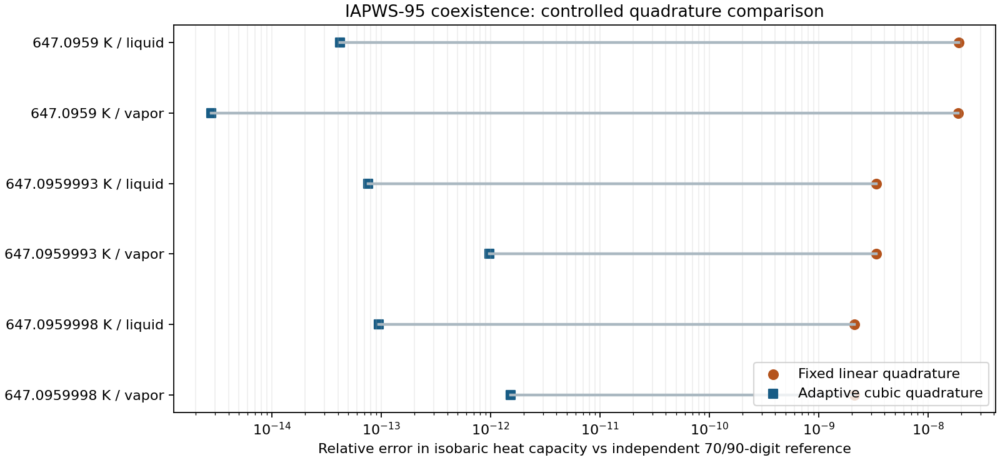

# Подальше підвищення точності — 17.10.2026

Перевірено локальний кандидат **1.35.2 / 699b1105f96b**. Є три додаткові поліпшення: точніша температура насичення за тиском, адаптивне інтегрування критичної рівноваги та коректне розрізнення близького і точного критичного стану.

На новій сітці **68 станів, 1088 порівнянь властивостей і 40 зворотних насичених кінців** — без перевищення допусків. Окремо підтверджено **8 запитів**, для яких IF97 не дає узгодженої пари фаз; вони явно відхиляються і не входять до числа успішно розрахованих станів.

## Відновлена основа

Після перезапуску середовище містило чисту **1.24.0 / b2d7f16**. З GitHub швидким переходом відновлено опубліковану **1.35.1 / 934113f**. Попередні неопубліковані файли, звіти та збірки `5032b7b90cef` / `dc980f228bec` не були доступні. Числові поліпшення відновлено заново й повторно перевірено; інші неопубліковані зміни попередньої сесії тут не відтворювалися.

У цьому звіті немає перенесених результатів попередньої сесії. Порівняння з 1.35.1 отримано запуском її вихідних модулів із того самого Git-коміту. Окремий контроль інтегрування використовує однакові EOS та еталони й змінює лише схему інтеграла, тому дозволяє оцінити саме додаткове поліпшення.

## Що змінено

- Проміжний критичний тиск і комбінації похідних обчислюються double-double арифметикою. Пошук густини обмежений стабільною гілкою й контролює поправку густини. Відновлено попередній принцип підвищеної точності без зовнішніх runtime-залежностей.
- **Насичення за P:** малу поправку температури збережено до завершення розрахунку. IF97 використовує високоточний зворотний вираз області 4; IAPWS-95 уточнює тиск рівноважних фаз через нахил Клапейрона. Кінцеве відображення T залишається звичайним Number, але похідні вже обчислені з урахуванням його малої поправки.
- **Насичення IAPWS-95 за T/P:** інтегруються похідні замість віднімання близьких фазових тисків і потенціалів. Кубічна координата біля δ=1 краще розділяє нецілі степені критичних доданків. Панелі інтегрування уточнюються до збіжності фазових густин; кількість вузлів не є єдиною підставою приймання.
- T-вхід IF97 зберігається без зайвого перетворення T→P→T. Близький P–T стан більше не підміняється точною критичною точкою через широкий допуск.
- Зворотні насичені h/s враховують округлення кінців у масштабі машинної точності; для v/ρ збережено T-вхід та враховано поширення його округлення. Додано окремі регресії фазової ознаки.

## Виміряне додаткове поліпшення

Контроль: те саме фундаментальне рівняння IAPWS-95, ті самі еталони й критерій завершення; попередній фіксований лінійний інтеграл проти адаптивного кубічного. Відносна похибка cp:

| T, K | Фаза | Лінійний інтеграл | Адаптивний кубічний |
|---|---|---:|---:|
| 647.0959 | liquid | 1.8921e-08 | 4.1966e-14 |
| 647.0959 | vapor | 1.8748e-08 | 2.7756e-15 |
| 647.0959993 | liquid | 3.3321e-09 | 7.5939e-14 |
| 647.0959993 | vapor | 3.3302e-09 | 9.6778e-13 |
| 647.0959998 | liquid | 2.1257e-09 | 9.4591e-14 |
| 647.0959998 | vapor | 2.1261e-09 | 1.5157e-12 |

Для насиченої рідини при **647,0959 K** похибка cp зменшилася приблизно з **1,89e-8 до 4,20e-14** відносно. Це поліпшення чисельного розв’язання рівнянь, а не така сама експериментальна точність фізичної моделі.



[Векторний PDF](accuracy-followup/quadrature-improvement.pdf), [контрольні числа](accuracy-followup/quadrature-comparison.json), [повна таблиця нових значень](accuracy-followup/after.csv), [таблиця опублікованої 1.35.1](accuracy-followup/before.csv).

## Незалежні методи й покриття

Критичні IF97 області 3/4 та IAPWS-95 обчислено окремим Python/multiprecision кодом на **70 і 90 цифрах**. Результати властивостей двох точностей збігаються краще за `1e-25` відносно. Звичайні IF97 області 1/2 перевіряються незалежними фундаментальними функціями Python iapws з подвійною точністю. Коефіцієнти взято з **iapws 1.5.5**. CoolProp **8.0.0** використовується для початкових наближень та добре обумовленої транспортної опорної похідної при 1,5 Tc. Для критичного P–T початкові наближення додатково замінено незалежною високоточною бісекцією, коли вони були недостатніми.

Фіксоване P-насичення еталона розв’язується спільно для двох густин і температури; різниці потенціалів нормовано за фазовим розривом, щоб не прийняти вироджений однаковий корінь фаз. Код продукту в генерації еталонів не використовується. μ/λ/ν/Pr перевірено окремими Python-кореляціями IAPWS, які отримують високоточні термодинамічні похідні.

Перевірено P=0,1…22,0639999999 MPa, насичення за T аж до **647,095999999 K = Tc−1e-9 K**, а також P–T при Pc з обох боків Tc. Допуск властивостей — `2e-9` відносно з явними абсолютними порогами для малих величин; для T критичного насичення за P — `2e-12 K` абсолютно. P–h/P–s перевірено на незалежних насичених кінцях; довільні однофазні інверсії на субмашинній відстані від Tc цим набором не підтверджуються.

| Перевірка | Результат |
|---|---:|
| Незалежні стани | 68/68 |
| Величини: p, T, ρ, v, h, s, u, cp, cv, w, α, ∂ρ/∂p, μ, ν, λ, Pr | 1088/1088 |
| Зворотні P–h/P–s насичені кінці | 40/40 |
| Нові регресійні тести | 78/78 |
| Повний unit-набір | 926/926 |
| Core, збірка, пакування та відтворюваність | 14/14 |
| Chromium та Firefox, кожен | 17 сценаріїв, 416 чисел, 12 перевірок координат |

В обох браузерах помилок JavaScript немає; числа проходять ті самі допуски. Перевірено точки на T–s, h–s, p–h та роботу після вимкнення мережі в уже завантаженому застосунку. Це цільова перевірка точності й координат, а не повторний повний аудит усіх графічних функцій.

На цій самій новій сітці опублікована 1.35.1 має **18 станів у допуску, 35 із відхиленнями, 15 відмов**. Для нової збірки — 68 станів у допуску, 0 відхилень і 0 відмов серед станів з еталоном. Це порівняння з опублікованою версією, а не з недоступною попередньою локальною збіркою.

## Межі та відтворення

8 запитів IF97 підтверджено незалежною перевіркою спінодалі на 70 цифрах: тиск області 4 перевищує верхню межу стабільної парової гілки області 3 приблизно на **0,000369…0,000629 Pa**. Вища розрядність не створює узгоджену пару фаз у цьому формулюванні. IAPWS-95 для відповідного критичного околу перевірено окремо. Точну сингулярну критичну точку IAPWS-95 явно відхилено; IF97 у точній критичній точці повертає невизначений cp.

Точність моделі та чутливість до виміряних p/T залишаються фізичними обмеженнями. Наведені похибки стосуються скінченної перевіреної сітки. Попередній нейтронно-фізичний screening реакторного модуля не змінювався і не входить у висновок цього аудиту.

Основні команди з кореня репозиторію:

```bash
export ACCURACY_DIR=.release/accuracy-followup
python3 scripts/generate-accuracy-followup.py --fixture
node scripts/audit-accuracy-followup.mjs
AUDIT_INVERSES=1 node scripts/audit-accuracy-followup.mjs
node scripts/compare-saturation-quadrature.mjs
python3 scripts/render-accuracy-followup.py
node --test tests/accuracy-followup.test.mjs
node scripts/verify-release.mjs --core
```

Python-залежності: iapws 1.5.5, CoolProp 8.0.0, mpmath, matplotlib. Перевірено на Node 22, як у CI. У цій сесії Python-пакети встановлено в `/tmp/water-reference` (PYTHONPATH), Node — `/tmp/water-node22/node_modules/.bin/node`.

Браузер: сервер `python3 -m http.server 8080 --bind 127.0.0.1 --directory dist`, `BROWSER_NAME=chromium` або `firefox`, скрипт `scripts/check-accuracy-followup-browser.cjs`. Chromium використовує `/usr/bin/chromium`; Firefox встановлено через Playwright у `/tmp/water-browsers`. Сервер віддає тільки dist і слухає тільки loopback.

Контрольні суми й сирі результати — [NUMERICAL_PRECISION_FOLLOWUP_ACCEPTANCE.json](NUMERICAL_PRECISION_FOLLOWUP_ACCEPTANCE.json). Підсумковий статус: **passed-with-model-limits**.

Для локального збереження цієї роботи створено [архів вихідних змін](/workspace/water-steam-if97/.release/accuracy-followup/source-backup.zip). Він накладається на опублікований коміт `934113f`; після розпакування потрібно виконати `npm run build`. Архів не містить великих згенерованих HTML/JS-файлів — вони відтворюються збіркою.
