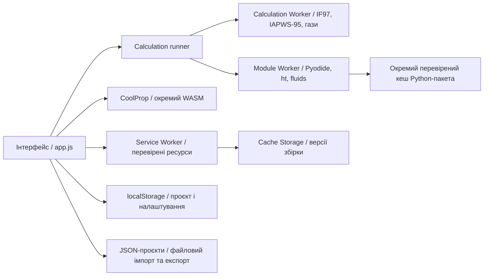

# Архітектура PWA з локальними розрахунками та офлайн-запуском

Рішення автора від 19.10.2026. Кандидат 1.38.1. Єдиний формат програми —
багатофайлова PWA; вимоги запуску одним HTML і через file:// знято.

## Поточна реалізація

- HTML, CSS, JavaScript, Worker, WASM, manifest та іконки розповсюджуються
  як локальні ресурси одного походження. Підтримано підкаталог GitHub Pages.
- Збірка визначає ресурси й SHA-256 кожного з них. Service Worker установлює
  основний поточний комплект; помилка завантаження або хешу видаляє частковий кеш.
- Інтерфейс показує готовність після перевірки повноти кешу. Натискання кнопки
  встановлення PWA саме по собі не є доказом готовності офлайн.
- Нові розрахункові Worker і CoolProp отримують версійовані ресурси з кешу.
  Service Worker обслуговує файли; тривалі розрахунки виконують окремі Worker.
- Оновлення готує новий комплект. Перед застосуванням інтерфейс зберігає проєкт;
  помилка збереження блокує перезавантаження. Старі кеші потрібні відкритим
  вкладкам попередньої версії; не можна підміняти їхні ресурси новими.
- Збірка більше не створює standalone.html та видаляє його застарілі копії
  в корені й dist/. Автономні HTML-звіти результатів залишаються експортом.

SheetJS розповсюджується як окремий версійований `assets/sheetjs.js`.
Service Worker перевіряє й кешує його у складі основного комплекту.
Інтерфейс виконує файл лише перед першим XLSX/ODS/XLS-експортом, ділить
одне завантаження між запитами й дозволяє повторення після помилки.
CSV використовує власний writer без запуску SheetJS. Node API `writeTabular`
зберігає синхронну поведінку для інструментів та модульних перевірок.

Математичні моделі та допуски ця міграція не змінює. Пряме приймання чисел
Steam97Web, зокрема P03/P04, залишається окремою відкритою задачею.

## Як запускати без інтернету

1. З HTTPS-сайту: відкрити програму з мережею, дочекатися готовності офлайн,
   за бажанням установити її. Надалі можна відкрити ту саму адресу або іконку
   без мережі, доки збережені ресурси й дані браузера.
2. З повного ZIP: розпакувати, запустити python serve.py (або py -3 serve.py
   у Windows), відкрити http://localhost:8080/ та підготувати кеш. Усі ресурси
   вже в ZIP, тому інтернет навіть для цього першого локального запуску не потрібен.
   Після готовності сервер можна зупинити. При очищенні кешу запустити його знову.

serve.py використовує лише стандартну бібліотеку Python, слухає loopback і
обслуговує статичні файли. Це засіб розповсюдження, а не розрахунковий backend.
Потрібно зберігати ту саму адресу й порт: localhost, 127.0.0.1 та HTTPS-сайт
мають окремі сховища. Наявність Python потрібна лише для локального ZIP-сценарію.

Браузер може видалити дані сховища; установка PWA не гарантує їх збереження.
Користувач повинен мати файловий JSON-експорт проєктів. Відсутній кеш можна
відновити з сайту або з локального ZIP. Якщо проєкт видалено браузером, потрібна
резервна копія. Посилання на зовнішні джерела потребують мережі.

## Спільний інтерфейс модулів — реалізовано в 1.37.0

Calculation runner і Worker використовують версійований протокол із реєстром
адаптерів `water`, `gas-tables`, `workflows`, SHA-256 ревізією реалізації,
явними одиницями, структурованими помилками, попередженнями та межами моделі.
Вода й газові таблиці мають властивості з одиницями й доступністю; workflows
зберігають чинні схеми результатів. Є AbortSignal і завершення Worker при
скасуванні. Наявні фонові виклики інтерфейсу проходять через цей же протокол.

Повний контракт і приклади: [CALCULATION_MODULES_UK.md](CALCULATION_MODULES_UK.md).

## Завантажувані бібліотеки: ht / fluids реалізовано в 1.38.0

Основний кеш готується автоматично. ht / fluids мають спільний додатковий пакет
з Pyodide, NumPy та SciPy, що готується користувачем окремо. Маніфест фіксує
версії, розміри та SHA-256; завершальний маркер записується після всіх перевірок.
Web Locks узгоджує завантаження й видалення між вкладками. Невдалий пакет
видаляється; проєкти не зачіпаються. Зміна UI не змінює кеш незмінного пакета.
[Докладний контракт та обмеження](PYTHON_LIBRARIES_UK.md).

Нижче — напрям подальшого розвитку менеджера пакетів.

### Реєстр модулів

Кожний модуль має id, версію, версію протоколу, перелік методів, залежності,
файли з хешами/розмірами, ліцензії та сумісність із версією застосунку.
Рекомендовані групи: core; термофізичні движки; середовище Python/WASM;
ht/fluids; додаткові речовини й суміші. Межі пакетів уточнюються вимірюваннями.
Спільні NumPy/SciPy завантажуються один раз для сумісного середовища.

### Завантаження й кеш

Стани: не завантажено → завантаження → перевірка → готовий офлайн; окремо —
помилка, бракує місця, пошкоджений/відсутній ресурс, доступне оновлення.
Залежності встановлюються узгодженим комплектом у проміжний кеш. Готовність
публікується тільки після повної перевірки; частковий набір не підмінює робочий.
Активний розрахунок прив'язаний до конкретної версії модуля.

Інтерфейс показує розмір до завантаження та готовність кожного модуля. Потрібні
оцінка квоти, доступний запит на постійне сховище, повторення завантаження та
очищення непотрібних версій після завершення клієнтів. Видалення ресурсів модуля
не повинно видаляти проєкти. CDN/PyPI не є runtime-залежністю офлайн-розрахунку.

### Виклик движків

Реалізований протокол передає id, moduleId, engineVersion,
implementationRevision, methodId та типізовані аргументи. Результат містить
величини з одиницями для води/газів, модель, версію, попередження й структуровані
помилки. Runner відкидає застарілі відповіді. Для ht / fluids підключено окремий runtime та менеджер ресурсів.
Скасування має припиняти обчислення; для синхронного Python це може вимагати
завершення Worker із подальшим відновленням середовища з локальних ресурсів.

Pyodide запускається в окремому Worker після звернення до Python-модуля.
Публічні функції, класи й масиви передаються через фіксований міст JSON.
Наявність пакета у сховищі ще не означає готовності всіх його функцій.

### Користувацькі дані

Зараз проєкт і налаштування використовують наявні localStorage/JSON-механізми.
Для великих колекцій і результатів заплановано IndexedDB зі схемою, версією
та міграціями. Це окрема зміна; поточні дані автоматично не перенесено.
Зберігати входи, одиниці, базиси, моделі й версії движків. При відсутності
потрібного модуля дозволяти читання й експорт проєкту та пояснювати, що потрібно
для повторного обчислення. Нові версії не повинні мовчки змінювати збережену модель.

## Приймання

- Відсутність однофайлового артефакту; повна відтворювана PWA-збірка та ZIP.
- Новий запуск/перезавантаження без мережі, включно з новим Worker і CoolProp.
- Збереження/імпорт/експорт проєктів, діаграми й формати результатів офлайн.
- Оновлення зі збереженням проєкту; стара відкрита вкладка зберігає свої ресурси.
- Обрив завантаження, неправильний хеш, очищення кешу, невдала та успішна repair-спроби.
- Chromium та Firefox; мобільні розміри. Установку на фізичних Android/iOS
  перевіряти окремо й не виводити з результатів настільного браузера.

Поточні команди: npm run build; npm test; npm run test:pwa; npm run package;
python scripts/verify-package.py; npm run verify:release. Фактичні результати
міграції зберігаються в .release/ і підсумковому звіті PWA_MIGRATION_UK.md.

Історичні acceptance JSON, скриншоти й звіти попередніх спринтів не переписуються:
згадки старого формату описують тодішню перевірку, а не актуальну вимогу продукту.
