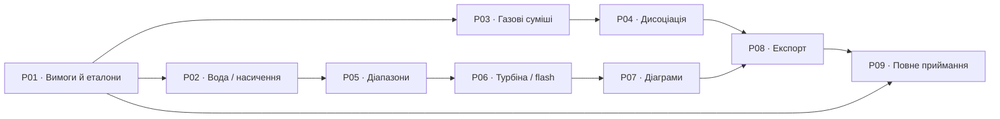

# Спринти повного функціонального покриття Steam97Web

Локальний кандидат **1.35.11 / P03** додає газову модель BSW2003 для восьми компонентів: 200…3300 K, P–T/P–h/P–s, обидва базиси складу, проєкти й чотири табличні формати. Числові та браузерні перевірки описано у [звіті P03](STEAMTABLES_P03_UK.md); первинна перевірка коефіцієнтів і пряме приймання Steam97Web залишаються відкритими.

План від 18.10.2026. База реалізації: **1.35.4**, коміт `9c87d171d093ee2a4f7ec7a92e3c10d1de95f123`. Статус: **P01 підготовлено; P02-01 і відому частину P02-02 виконано у 1.35.5; пряме приймання оригіналу заблоковане**. [Звіт P01](STEAMTABLES_P01_UK.md) зберігає історичні 9 відмов; [P02](STEAMTABLES_P02_UK.md) виправив їх і перевірив 745 водяних та 4657 регресійних запитів. Повний інвентар залишається відкритим. Номери релізів визначаємо за фактичним складом змін; P01–P09 — сталі ідентифікатори робіт.

Мета: усі задачі цільового [Steam97Web](https://www.steamtablesonline.com/steam97web.aspx?lang=ru) можна виконати в нашій програмі з відповідними входами, моделлю, складом, фазою, одиницями, діапазоном, виходами й операціями з результатом. Реалізація та оформлення власні; нові можливості понад цей обсяг мають наступну чергу.

Джерела плану: [стратегія](PRODUCT_STRATEGY_UK.md), [початкова матриця вимог](STEAMTABLES_PARITY_MATRIX.json), [ідентифікатори спринтів і прив’язка вимог](STEAMTABLES_PARITY_SPRINTS.json), [перевірки версії 1.35.4](INPUT_SENSITIVITY_SPRINT_UK.md).

## Початковий стан і межі знань

Початкова матриця від 16.10.2026 містить **82 пункти: 70 реалізованих, 8 частково реалізованих і 4 відсутніх**. Відсутні: дисоціація та експортери XLS/XLSX/ODS. P01 додав чотири окремі вимоги турбіни: поточні 86 пунктів мають 69 присутніх, 10 часткових і 7 відсутніх реалізацій. Ці числа описують інвентар, а не відсоток повноти чи підтвердженої відповідності. Матриця ще не охоплює гарантовано кожний перемикач оригіналу.

Версія 1.35.4 додала незалежну перевірку 4657 зворотних запитів, чутливість входів і контроль коренів. Ці докази використовуємо для регресії. Прямі результати Steam97Web потрібні додатково для приймання відповідності.

Повний перелік функцій насичення, деякі режими після реєстрації, газова модель та розширені діапазони ще потребують перевірки. Попередня спроба інтерактивного доступу з executor була заблокована; цей план не підтверджує нового доступу чи нового живого аудиту. При недоступності функції записуємо конкретний блокер і продовжуємо незалежні роботи з уже визначеними вимогами. Обов’язкова неперевірена функція залишає фінальне приймання відкритим.

## Черговість і результати

| ID | Спринт | Конкретний результат | Залежності |
|---|---|---|---|
| P01 | Інвентаризація та контрольні приклади | Реєстр режимів, доступних після реєстрації функцій, джерел, невизначеностей і перші збережені зіставлення; раннє дослідження газової моделі | Початок |
| P02 | Вода, пара та повне насичення | Підтверджені пари входів і виходи в поточних діапазонах; усунені встановлені пропуски селектора насичення | P01: вимоги водяного блоку |
| P03 | Газові таблиці та суміші фіксованого складу | Узгоджені модель, базис складу, система відліку, властивості та потрібні зворотні режими | P01: контракт газового блоку |
| P04 | Дисоціація | Властивості з підтвердженою моделлю дисоціації в потрібних межах | P03 і визначення моделі/виходів |
| P05 | Діапазони й транспортні властивості | Перевірені межі кожної потрібної властивості та реалізовані обґрунтовані розширення | P02 |
| P06 | Турбіна та флеш-випарник | Усі підтверджені варіанти трьох турбінних і двох flash-розрахунків, поля, виходи й одиниці | P02, P05 |
| P07 | Діаграми та робота із серіями | T–s, h–s, окремий паровий h–s, фонові сімейства, точки, серії, редагування, збереження і друк | P02, P05, P06 |
| P08 | Табличні формати експорту | Справжні XLSX, ODS, XLS та узгоджений CSV для потрібних наборів результатів | P02–P07 |
| P09 | Повне приймання аналога | Закрита матриця, пройдені всі сценарії та перевірене розгортання конкретного коміту | P01–P08 |

Це рекомендована черговість. P03 можна досліджувати після газової частини P01, а P05–P07 виконувати за готовими водяними контрактами, якщо газові питання залишаються відкритими. P08 може почати вибір бібліотеки й схеми даних раніше; завершення потребує всіх цільових виходів. Залежності означають готовність конкретних контрактів і приймальних результатів, а не обов’язкове очікування всіх непов’язаних питань попереднього спринту.

## P01. Інвентаризація та контрольні приклади

**Робота.** Переглянути всі відомі вкладки й селектори, включно з режимами після реєстрації, та доповнити матрицю. Уточнити перелік функцій насичення, поля турбіни/flash, газовий склад і модель, окремий паровий h–s, формати файлів і фактичні межі. Для газів одразу встановити доступність термодинамічних даних, види рівноваги та визначення вихідних величин. Окремі desktop-програми й Excel-надбудови за зовнішніми посиланнями автоматично не включати до обсягу вебкалькулятора.

**Артефакти.** Актуалізована матриця; реєстр питань і блокерів; специфікації готових модулів; збережені приклади оригіналу. Формат контрольного прикладу: ID вимоги, точне місце/варіант у Steam97Web, дата і джерело, модель, входи, одиниці, фаза, базис/склад, умови відліку, всі виходи з їхньою надрукованою точністю, незалежне джерело та заздалегідь обґрунтовані допуски.

**Приймання.** Кожна відома вимога отримала конкретний контракт або блокер; для першого спринту реалізації є готовий контракт і контрольні приклади. P01 може завершити підготовчу роботу з явними блокерами, проте `reference_inventory_complete` стає `true` лише після закриття всіх питань інвентаризації. Недоступність функції не дає їй статусу `verified`.

## P02. Вода, пара та насичення

**Робота.** Зіставити всі зазначені в матриці пари входів IF97/IAPWS-95 і вихідні властивості в поточних реалізованих діапазонах. Уточнені функції насичення реалізувати окремими задачами: задана величина, фаза/гілка, пошук усіх допустимих станів, результати обох фаз. Згадка довідки про «15 функцій» не є готовим переліком 15 нових режимів. Перевірити також узгоджені налаштування довкілля та ексергії.

**Технічний підхід.** Використати `src/engine.js`, `src/extra-inputs.js`, `src/iapws95.js`, `src/saturation-grid.js` та спільний Worker. Новий селектор використовує те саме фундаментальне ядро, що таблиці й діаграми. Відрізняти нестачу даних, кілька фізичних коренів, відсутність розв’язку й сингулярну величину. Зберегти контроль дублікатів, вибір гілки й сумісність проєктів 1.35.4.

**Приймання.** Для кожного підтвердженого режиму є контрольні приклади звичайних станів, насичених кінців, області біля Tc та допустимих неоднозначностей. Результати відтворюються через форму, Worker, таблицю, збереження й експорт; число коренів і фазові ознаки перевірено. Успішна інверсія відтворює обидва початкові входи. Розширення діапазонів має окреме приймання P05.

## P03. Газові таблиці й суміші фіксованого складу

**Поточний результат.** Одна поставка [1.35.11](STEAMTABLES_P03_UK.md): вторинні таблиці коефіцієнтів BSW2003, окреме ядро восьми компонентів, обидва базиси/одиниці складу, P–T/P–h/P–s, Worker, проєкт, експорт і офлайн. Первинна перевірка коефіцієнтів і пряме приймання B01/B03/B04 залишаються відкритими.

**Робота.** Підтвердити модель і діапазон для потрібних восьми компонентів: Ar, CO, CO₂, H₂O, N₂, Ne, O₂, SO₂. Узгодити молярні/масові частки, опорні стани h/s, одиниці, тиск і всі доступні в оригіналі способи задання задачі. За потреби додати модель, яка відповідає цьому контракту. NASA7 залишається доступною окремо з явним ідентифікатором моделі.

**Технічний підхід.** Відокремити дані компонентів, обчислення стану та перетворення складу від форми. BSW2003 реалізовано окремими `src/gas-bsw2003.js` і `src/gas-bsw2003-data.js`; попередні `src/gases.js`/`src/gas-data.js` не змінюються. Підтверджений контракт моделі й базис входить у збережений проєкт, результат і експорт. Старі розрахунки NASA7 продовжують відтворюватися у своїй моделі. Властивості для P04 надаються через визначений інтерфейс термодинамічних даних.

**Приймання.** Чисті компоненти, граничні склади, повітря й контрольні суміші проходять перевірку нормування, одиниць та опорних станів; підтверджено всі потрібні виходи й зворотні режими. Зіставлення з оригіналом та незалежним джерелом пояснює відмінності формуляцій. Наявність однакових назв компонентів сама по собі не закриває вимогу.

## P04. Дисоціація газів

**Уточнення P01.** Довідка задає модель калоричних властивостей дисоційованих газів до 2000 K за повного згоряння та λ > 1,05, пов’язану з Bücker/Span/Wagner 2003. Вона не визначає загальну постановку хімічної рівноваги. У 1.35.12 реалізовано дослідну калоричну поправку за відкритими рівняннями VDI4670/Modelica з окремо виведеною CO-гілкою. Повний первинний контракт і приймання оригіналу ще недоступні; блокери B01/B03/B04/B05 збережено у [звіті P04](STEAMTABLES_P04_UK.md).

**Вхідний бар’єр.** Відомі рівняння й коефіцієнти, базис складу та h/s, правила λ, межі P/T, зміст «Dissociation» й компонентних виходів, визначення cp/cv. Є off/on приклади оригіналу та незалежний спосіб оцінити цю модель. За невирішених питань продовжуємо дослідження.

**Робота.** Реалізувати підтверджену модель дисоціації й потрібні властивості, зберігши варіант без дисоціації. Реакційні/атомні баланси та загальний розв’язувач рівноваги потрібні лише якщо цього вимагають встановлені рівняння; вони самі по собі не доводять відповідності оригіналу.

**Технічний підхід.** Окреме чисте ядро поверх перевірених даних P03; явні модель, базис і обмеження у формі, проєкті та експорті. Метод і незалежний розв’язувач обрати після отримання рівнянь. Не замінювати потрібну модель іншою хімічною постановкою. Довгі обчислення виконувати у Worker зі скасуванням.

**Приймання.** Off/on значення, температура біля межі 2000 K, λ біля 1,05, допустимі P/склади, потрібні похідні й відмови перевірено за незмінними допусками. Збережено фізичні обмеження саме підтвердженої моделі; UI/проєкт/експорт відтворюють постановку. За потреби розділити P04 на ядро з еталонами й завершений сценарій; батьківська вимога лишається відкритою до приймання обох.

## P05. Діапазони й транспортні властивості

**Поточний результат.** Наукову частину виконано у [1.35.6](STEAMTABLES_P05_UK.md): карта всіх десяти вимог, N03/N04 та незалежні числові/браузерні перевірки. Пряме приймання оригіналу лишається відкритим (B01/B03/B06).

**Робота.** Побудувати карту «модель × властивість × фаза × діапазон». Перевірити фактичні крайні точки Steam97Web, версії кореляцій, обмеження плавлення/насичення й заявлену екстраполяцію. Пріоритет: IAPWS-95, μ, λ, ν, температуропровідність, Pr, поверхневий натяг і діелектрична проникність.

**Технічний підхід.** Працювати у `src/iapws95.js`, `src/equations.js`, `src/transport.js`, `src/dielectric.js`; зосередити перевірку допустимості в одному місці для кожної моделі/властивості. Окрема модель льоду або інший модуль не підміняє відсутній режим цільового водяного калькулятора. Відрізняти фізично підтверджений діапазон від явної екстраполяції оригіналу; потрібну екстраполяцію документувати окремим режимом з її межами. Якщо відмінність ще не розв’язана, відповідна вимога відкрита.

**Приймання.** Для кожної межі є точки на межі та з обох боків, де вони мають зміст; перевірено прямий і потрібні зворотні режими. Недоступна величина має пояснення у формі, результаті й експорті. Довільне розширення числової перевірки меж без перевірки формуляції не приймається.

## P06. Турбіна та флеш-випарник

**Поточний результат.** У [1.35.7](STEAMTABLES_P06_UK.md) виконано відомий контракт: 15 виходів турбіни, три режими, MW, lb/(kW·h), коректні різниці температур, два режими конденсату, історія/проєкт/CSV/друк. Пряме приймання всіх варіантів оригіналу залишається відкритим (B01/B03). Наступна незалежна задача — P07.

**Робота.** Зіставити розрахунок потужності, витрати й ККД турбіни та flash для насиченого/недогрітого конденсату: повний склад полів, допустимі режими вхідної пари, вихідні стани, питомі витрати, частки й витрати фаз, одиниці та моделі.

**Технічний підхід.** Використати `src/processes.js` та наявну форму/фонове виконання; спиратися на перевірені стани P02/P05. Вхідні й вихідні одиниці перетворювати на межі UI; баланси обчислювати з повних канонічних чисел.

**Приймання.** Пройдені типові та граничні режими оригіналу, незалежні баланси маси й енергії, зворотні задачі між потужністю/витратою/ККД, межі сухості та некоректні входи. Сценарій закінчується збереженням, повторним відкриттям і експортом усіх потрібних результатів.

## P07. Діаграми й серії

**Поточний результат.** У [1.35.8](STEAMTABLES_P07_UK.md) реалізовано документовані операції з точками, підписами та іменованими лініями/сплайнами, спільний стиль і відновлення вигляду. 172 незалежні стани, 108 контролів фонових ліній та SciPy перевіряють числа й геометрію. Локальний паровий масштаб не закриває вимогу окремої парової h–s: її межі, фонові сімейства та точна інтерполяція оригіналу залишаються B01/B03/B09.

**Робота.** Зіставити три цільові види, окремий діапазон парової h–s, усі потрібні фонові сімейства, точки, назви, стилі, лінії/криві, редагування, масштабування, одиниці, збереження й друк. Відсутній режим додавати до наявної спільної графічної системи.

**Технічний підхід.** Використати `src/diagram-chart.js`, `src/diagram-workspace.js`, модулі координат/даних і чинне ядро. Точки графіка, наведення та експорт отримують дані з одного набору станів. Числове уточнення ліній враховує межі фаз і областей; розриви не з’єднуються вигаданими станами. Графічна інтерполяція й розрахований термодинамічний процес мають відповідні назви та поведінку. Наявні додаткові види зберігаємо.

**Приймання.** Для кожного цільового виду перевірено числові координати, одиниці, фазові кінці, точки на фонових лініях і всі підтверджені операції з серіями. Chromium/Firefox, телефон і ПК, клавіатура/сенсорні дії за доступністю. Після збереження/відкриття відтворюються дані й потрібні налаштування; SVG/друк відповідають показаному набору.

## P08. XLSX, ODS, XLS та CSV

**Поточний результат.** [1.35.9](STEAMTABLES_P08_UK.md) реалізує підтверджені водяні набори у справжніх XLSX/ODS/BIFF8 та CSV UTF-8. Файли читаються незалежними openpyxl/odfpy/xlrd; перевірено офлайн-експорт і явні межі тексту XLS. Прямі файли оригіналу й невідомі газові набори залишаються відкритими.

**Робота.** Додати формати й набори експортованих результатів, підтверджені інвентаризацією: окремий стан, фазові таблиці, потрібні серії/розрахунки. Уточнити варіант старого XLS за реальним файлом оригіналу. CSV, перейменований на XLS, не закриває вимогу.

**Технічний підхід.** Спільний опис табличного результату з числовими значеннями, одиницями, моделлю, базисом та умовами відліку; окремі адаптери форматів поверх `src/export.js` і `src/learning-export.js`. Бібліотеку обрати за підтримкою потрібних форматів, браузера, автономного HTML та розміром; закріпити версію і хеш локально, включити ресурси до збірки/PWA. Перевірити розмір автономного файла до прийняття залежності.

**Приймання.** Файли відкриваються незалежним читачем відповідного формату; перевірено типи числових клітинок, Unicode, одиниці, структуру листів, повноту властивостей, точність і невизначені значення. Назви й текст зберігаються як текст. Експорт працює без мережі в PWA й автономній версії. Старі CSV/JSON-сценарії проходять регресію.

## P09. Повне приймання

**Підзадача P09-01.** [1.35.10](STEAMTABLES_P09_UNITS_UK.md) додає підтверджені одиниці транспортних властивостей, незалежну розмірнісну перевірку та наскрізні сценарії експорту/збереження. Повне приймання P09 залишається заблокованим B01–B09; виконана підзадача не закриває весь спринт.

**Робота.** Пройти кожний цільовий сценарій від введення до отримання результату, діаграми/таблиці, експорту, збереження та повторного відкриття. Перевірити всі заявлені одиниці й обидві мови, новий/очищений журнал, доступність дій, PWA з чистого встановлення та після оновлення, автономний HTML/ZIP, поточні версію й build ID на сайті.

**Приймання повного аналога.** Інвентаризація завершена; немає відкритих обов’язкових вимог і неперевірених обов’язкових режимів. Кожна вимога має докази оригіналу, незалежну числову перевірку, обґрунтований допуск та пройдений користувацький сценарій. Розбіжності розв’язані з явною фіксацією; реальний пропуск не закривається приміткою про інший модуль. CI й розгортання конкретного коміту успішні; на сайті перевірено його версію та збірку. Лише після цього фіксуємо завершення першого етапу продукту.

## Як виконувати кожний спринт

1. **Контракт задачі.** Вибрати конкретні вимоги матриці, зафіксувати входи/виходи й межі. До написання алгоритму отримати достатні джерела й контрольні приклади для цієї задачі.
2. **Числове ядро.** Чисті обчислювальні функції, канонічні одиниці, ідентифікатор моделі та явна невизначеність. При необхідності виділити внутрішні частини великих поточних файлів, зберігши публічний інтерфейс; загального переписування програми цей план не потребує.
3. **Один завершений сценарій.** Підключити ядро до Worker, форми, таблиці/графіка, збереження й потрібного експорту. Для сумісності проєктів зберегти попередню модель/базис; старі значення перераховуються за своїми входами.
4. **Докази.** Скінченна незалежна сітка, точки оригіналу, контроль залишків і фізичних балансів, браузерний сценарій. Фіксувати версію/хеш зовнішньої бібліотеки, залежність методів і точність надрукованих еталонів. Допуски визначати до перегляду відхилень; для коротко надрукованих чисел враховувати округлення джерела.
5. **Приймання й реліз.** Оновити матрицю лише за наявними доказами; зібрати одну незмінну версію; прогнати відповідні тести та регресію; оформити звіт і SHA-256 доказів. Збірку не запускати одночасно з перевірками, що читають її файли. Пуш/публікація — окремий крок відповідно до поточного запиту користувача.

Для розрахункових змін зберігаємо поточні 4657 незалежних інверсій як регресійний набір, додаючи потрібні нові випадки. Швидкі профілі нових модулів підключаємо до CI на змінах, повні — до релізного приймання. Тести перевіряють ризики й вимоги; дублювання алгоритму продукту не вважаємо незалежним еталоном. Повний релізний набір залишається умовою публікації main.

## Статуси, оцінювання й зміна обсягу

План спринтів зберігає залежності та відповідальних за вимоги, матриця — фактичні стани реалізації й відповідності. Для задач використовуємо `planned`, `ready`, `in_progress`, `blocked`, `done`. Уточнення не робить реалізованою відсутню функцію; готовий код не робить автоматично підтвердженим паритет. Для P01 допустимі зареєстровані невідомі; P09 вимагає їх повного закриття.

Календар і трудомісткість визначаємо після P01 за конкретними задачами. P03 реалізовано одним локальним спринтом; первинне та пряме приймання відкрите. Локальний дослідний обсяг P04 реалізовано; повний обсяг визначається після підтвердження первинних рівнянь і контракту оригіналу. Якщо створено дочірні ID, їх прив’язуємо до тих самих вимог; батьківський спринт залишається відкритим до приймання всього обсягу. Нові знайдені вимоги додаємо до матриці й прив’язуємо до спринту, не втрачаючи історії джерел. Відсоток покриття вводимо після завершення інвентаризації й фіксації знаменника. Показники до того: відкриті вимоги, невідомі контракти, контрольні приклади та пройдені користувацькі сценарії.

**P02-01 і підтверджені сценарії P02-02 виконано.** [Поточні задачі P02](steam97-p02/tasks.json) зберігають блокери повного селектора насичення й ексергії. Поки вони відкриті, незалежно доступна карта наукових діапазонів P05 та дослідження газових даних P03/P04. P03 у 1.35.11 додав технічні коефіцієнти з вторинного джерела та повний локальний сценарій; оригінальні базиси й первинне підтвердження ще відкриті. У 1.35.12 реалізовано локальний дослідний сценарій P04: калорична поправка, Worker, проєкт, чотири формати й офлайн. Наступна предметна задача для повного приймання P04 — первинне підтвердження моделі та прямі off/on приклади Steam97Web, включно з визначеннями похідних і компонентних виходів.
