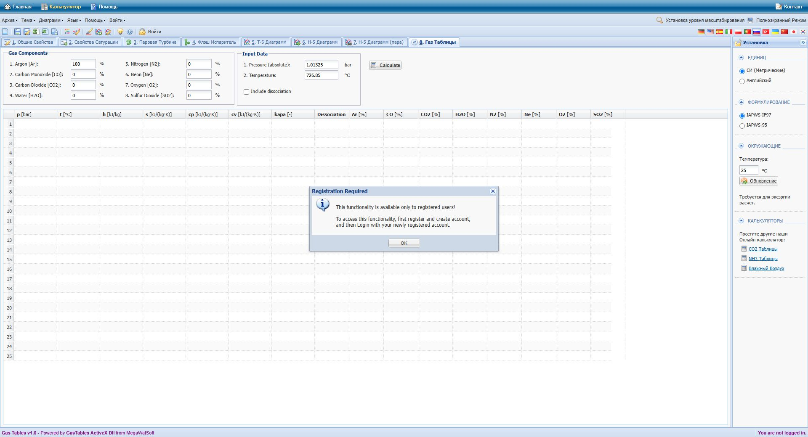

# Перевірка Steam97Web: P03 та P04

Дата: 19.10.2026 (Europe/Kiev). Метод: підключений Chrome, введення через інтерфейс, читання відображених таблиць і збереження скриншотів.

## Висновок

Числове зіставлення з оригіналом **не виконане через вимогу реєстрації**. Усі 20 фактично запущених через Calculate випадків оригіналу повернули Registration Required, без числових результатів. Це обмеження доступу, а не доказ збігу чи розбіжності P03/P04. Для нашої опублікованої версії 1.35.12 (збірка 8976baaf14e1) зібрано 19 успішних розрахунків і одну помилку діапазону. Код сайту не змінювався.

Джерела: [оригінал](https://www.steamtablesonline.com/steam97web.aspx?lang=ru), [наша версія](https://lamerroma.github.io/water-steam-if97/), [відкрита довідка оригіналу](https://www.steamtablesonline.com/ru/help_ru.aspx). Довідка описує воду/пару і не підтвердила базис газового складу чи алгоритм λ. Її DOM збережено окремо.

## Спостережені налаштування оригіналу

- Вкладка: «8. Газ Таблицы». Підпис: «Gas Tables v1.0 - Powered by GasTables ActiveX Dll from MegaWatSoft».
- Система: СИ (Метрические); вхід p — **bar, absolute**, t — **°C**. Перерахунок: p[bar]=10·p[MPa], t[°C]=T[K]−273,15.
- Бічний перемикач «IAPWS-IF97» вибраний. Це спостереження інтерфейсу; воно не доводить застосування IF97 до газів або тотожність GasTables та BSW2003.
- Вісім полів компонентів: Ar, CO, CO2, H2O, N2, Ne, O2, SO2; кожне має позначення %. **Видимого вибору молярного/масового базису немає. Фактичний базис не встановлено.** Числа суміші введено як надано користувачем. Для чистих компонентів ця неоднозначність не впливає на 100 %.
- «Include dissociation»: початково вимкнено; для кожної пари перевірено обидва стани.
- Видимого поля λ, вибору палива або умов утворення газу немає. Чи визначається λ всередині алгоритму — **невідомо**. Значення 1,2 не можна приписувати налаштуванню оригіналу.
- Видимі колонки результатів: p [bar], t [°C], h [kJ/kg], s/cp/cv [kJ/(kg·K)], kapa [−], Dissociation та вісім компонентів [%]. Густини й швидкості звуку в газовій таблиці немає.
- «Dissociation» — лише назва колонки. Її числовий/логічний зміст, одиниці та зв’язок зі ступенем дисоціації не встановлені.
- Сесія: «You are not logged in.»

Точний текст блокування (спостережено у кожному випадку):

```
Registration Required
This functionality is available only to registered users!
To access this functionality, first register and create account,
and then Login with your newly registered account.
```

## Матриця фактично перевірених входів

Чисті компоненти: кожен із Ar, CO, CO2, H2O, N2, Ne, O2, SO2 = 100 %, решта = 0; T=1000 K, p=0,101325 MPa; в оригіналі 726,850 °C та 1,01325 bar; дисоціація вимкнена. Для всіх — Registration Required.

Суміш: N2=72,633612 %, O2=3,219575 %, CO2=8,048938 %, H2O=16,097875 %, решта=0; сума=100 %. Молярний базис явно вибрано на нашому сайті; на оригіналі він не підтверджений. **Оригінал після втрати фокусу/Calculate відображає округлений склад: N2=72,63 %, O2=3,22 %, CO2=8,05 %, H2O=16,1 % (сума також 100 %).** Вводилися повні задані числа; внутрішні значення серверного запиту не досліджувалися. Отже, точний початковий склад на оригіналі не підтверджений. Наші таблиці нижче розраховані для повного заданого складу, тому їх не можна називати порівнянням за підтверджено однаковими ефективними входами. Інтерпретація як продуктів повного згоряння CH4 при λ=1,2 надана користувачем; вона не є результатом оригіналу.

| T, K | t оригіналу, °C | p, MPa | p оригіналу, bar | Стани | Оригінал |
|---:|---:|---:|---:|---|---|
| 1200 | 926.850 | 1 | 10 | off та on | Registration Required |
| 1600 | 1326.850 | 1 | 10 | off та on | Registration Required |
| 2000 | 1726.850 | 1 | 10 | off та on | Registration Required |
| 1600 | 1326.850 | 0.01 | 0.1 | off та on | Registration Required |
| 1600 | 1326.850 | 5 | 50 | off та on | Registration Required |
| 2000.001 | 1726.851 | 1 | 10 | off та on | Registration Required |

2000,001 K не спричинило видимої температурної помилки оригіналу: показано вимогу реєстрації. Це **не свідчить**, що розрахункова модель приймає цю температуру; порядок перевірки діапазону після входу невідомий.

## Результати нашої версії

Модель BSW2003, P–T, молярні %, вхідні одиниці MPa та K. Для on обрано «Калорична поправка VDI4670 · дослідна», «Повне згоряння у звичайному повітрі», λ=1,2 введено явно. Цей вибір моделі відповідає меті перевірки технічних газових таблиць; тотожність моделі оригіналу не доведена.

Нижче — точні рядки відображення таблиці, без додавання прихованої точності. Повні таблиці (також P, T, M, R, u, v, Z, ентропія змішування, склад у двох базисах та додаткові рядки on) є у JSON і DOM-файлах. T у результатах сайт показує в °C, хоча вхід заданий у K.

| Випадок | h, kJ/kg | s, kJ/(kg K) | cp, kJ/(kg K) | cv, kJ/(kg K) | ρ, kg/m³ | w, m/s | κ, − |
|---|---:|---:|---:|---:|---:|---:|---:|
| pure-Ar | 378,1836 | 0,67521743 | 0,52030488 | 0,31218293 | 0,48685398 | 588,95664 | 1,6666667 |
| pure-CO | 800,24314 | 1,4076099 | 1,1847975 | 0,88795804 | 0,34134618 | 629,34186 | 1,3342944 |
| pure-CO2 | 779,82515 | 1,334272 | 1,234207 | 1,0452804 | 0,53631931 | 472,30679 | 1,1807425 |
| pure-H2O | 1 489,9459 | 2,6002321 | 2,2922684 | 1,8307379 | 0,21954129 | 760,18597 | 1,2521008 |
| pure-N2 | 792,11899 | 1,3961368 | 1,167215 | 0,87041799 | 0,34139493 | 630,87204 | 1,3409822 |
| pure-Ne | 748,68359 | 1,3367164 | 1,0300387 | 0,61802319 | 0,24592524 | 828,66907 | 1,6666667 |
| pure-O2 | 732,51651 | 1,2814284 | 1,0900672 | 0,83022371 | 0,38994627 | 584,09702 | 1,3129801 |
| pure-SO2 | 551,5189 | 0,950316 | 0,84748733 | 0,71769133 | 0,78064811 | 391,49697 | 1,1808521 |
| mix-1200K-1MPa-off | 1 124,125 | 1,3159053 | 1,3386061 | 1,0397401 | 2,7883179 | 679,50531 | 1,287443 |
| mix-1200K-1MPa-on | 1 124,378 | 1,316116 | 1,3405821 | 1,0417162 | 2,7883179 | — | — |
| mix-1600K-1MPa-off | 1 674,8344 | 1,7114868 | 1,4098901 | 1,1110241 | 2,0912384 | 778,98503 | 1,2690004 |
| mix-1600K-1MPa-on | 1 677,7631 | 1,7133173 | 1,42445 | 1,1255841 | 2,0912384 | — | — |
| mix-2000K-1MPa-off | 2 248,8212 | 2,0314955 | 1,4569342 | 1,1580682 | 1,6729907 | 867,17376 | 1,2580729 |
| mix-2000K-1MPa-on | 2 266,6064 | 2,0403881 | 1,5329982 | 1,2341322 | 1,6729907 | — | — |
| mix-1600K-0.01MPa-off | 1 674,8344 | 3,0878155 | 1,4098901 | 1,1110241 | 0,020912384 | 778,98503 | 1,2690004 |
| mix-1600K-0.01MPa-on | 1 679,2673 | 3,090586 | 1,4383217 | 1,1394557 | 0,020912384 | — | — |
| mix-1600K-5MPa-off | 1 674,8344 | 1,2304806 | 1,4098901 | 1,1110241 | 10,456192 | 778,98503 | 1,2690004 |
| mix-1600K-5MPa-on | 1 677,5785 | 1,2321957 | 1,4228948 | 1,1240288 | 10,456192 | — | — |
| mix-2000.001K-1MPa-off | 2 248,8226 | 2,0314962 | 1,4569343 | 1,1580683 | 1,6729899 | 867,17397 | 1,2580728 |
| mix-2000.001K-1MPa-on | — | — | — | — | — | — | — |

Для 2000,001 K без дисоціації отримано результат; з VDI4670 — точна помилка:

> VDI4670: локальний дослідний діапазон 1200…2000 K, 0,01…5 МПа. / Local experimental range: 1200…2000 K, 0.01…5 MPa.

У режимі on w і κ відображено як «—». Окреме cp/cv відображається, але його не слід підміняти ізентропним показником. Склад, M, R, ρ, v та Z у спостережених парах on/off незмінні. Числового ступеня дисоціації наш результат не містить; Δh, Δs, Δcp — калоричні поправки, а не ступінь дисоціації.

## Прирости on мінус off

У таблиці використано окремо відображені сайтом Δ, які точніші за віднімання округлених h/s/cp. JSON також містить віднімання показаних значень з явною відповідною назвою. Для оригіналу всі прирости недоступні.

| T, K | p, MPa | Δh, kJ/kg | Δs, kJ/(kg K) | Δcp, kJ/(kg K) |
|---:|---:|---:|---:|---:|
| 1200 | 1 | 0,25295138 | 0,00021079281 | 0,0019760618 |
| 1600 | 1 | 2,9287889 | 0,0018304931 | 0,014559959 |
| 2000 | 1 | 17,785186 | 0,008892593 | 0,076064006 |
| 1600 | 0.01 | 4,4329067 | 0,0027705667 | 0,028431594 |
| 1600 | 5 | 2,7441366 | 0,0017150854 | 0,013004693 |
| 2000.001 | 1 | помилка діапазону | помилка діапазону | помилка діапазону |

## Що підтверджено, а що залишається відкритим

1. Підтверджено доступність 8 полів компонентів і перемикача дисоціації оригіналу, але всі розрахунки закриті реєстрацією. Не створювався обліковий запис і не обходилося обмеження.
2. На нашому сайті спостерігається межа VDI4670 1200…2000 K, 0,01…5 MPa; перевірені крайні точки включено.
3. Додаткова спостережена розбіжність: поля складу оригіналу округлюють введені шість знаків до двох; наш сайт зберігає задані значення. JSON розділяє attempted_input і observed_fields_after_calculate. Файл input-audit.json фіксує саме цю невідповідність, а не збій збору.
4. Відмінності інтерфейсу: наш сайт явно задає базис, λ й умови утворення та показує густину; газова таблиця оригіналу цих видимих елементів не містить. Це не числові розбіжності моделей.
5. Нулі h/s оригіналу невідомі. Наш UI заявляє h=s=0 для чистих компонентів при 273,15 K і 0,101325 MPa, з ентропією змішування для суміші. Абсолютне зміщення h/s не оцінювалося. Після отримання оригінальних чисел слід перевірити сталість зміщення на кількох температурах і окремо зіставити on−off.
6. Числову відповідність P03 та P04, семантику kapa/Dissociation оригіналу, його модель, базис складу й визначення λ **не підтверджено**. Для продовження потрібна авторизована сесія оригіналу з доступом до Gas Tables.

## Артефакти

- steam97-reference-cases.json: 20 випадків, точні входи, налаштування, усі відображені властивості нашого сайту, помилки, посилання на докази, прирости. null означає відсутність даних, а не нуль.
- steam97-evidence/original-<id>.png: 20 скриншотів оригіналу з входами та Registration Required.
- steam97-evidence/original-<id>.txt: DOM кожного випадку.
- steam97-evidence/ours-<id>.txt: повні DOM із налаштуваннями й результатами/помилкою.
- steam97-evidence/ours-boundary-error.png: підтвердження помилки 2000,001 K.
- steam97-evidence/original-help.txt: переглянута довідка.


